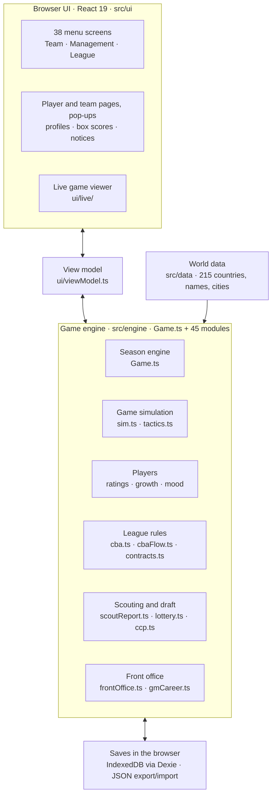
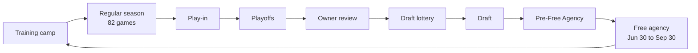

# Feature map

What Basketball Manager has today, how the pieces fit together, and where each one lives in the code. Check here before building on or changing a feature, and keep it current when features are added, moved or removed.

- `docs/SPEC_STATUS.md`: the spec, point by point, with status.
- `docs/HANDOFF.md`: the product spec and the rules the engine follows.
- `CHANGELOG.md`: what changed and when (shown in the game as "What's new").

_Last reviewed: 2026-10-17 (true potential compressed above 70: `potential.ts` `compressT` (70 + 0.55 × excess) in `initCeil`, pace `dv0.k` raised to keep growth, `compressTruePot` + `db.potV` for older saves, `Game.draftLevel` no longer overrides it; advanced stats rework, method in `docs/ADVANCED_ESTIMATES.md`: `sim.ts` box fields `onF onA onPO onPD xF xA xP`, lineup `Stints` (`stO`/`stD`) → `Game.addStints` → `db.rapm`; `advanced.ts` `finishImpact` (RAPM λ `RAPM.lambda` 10,000, on/off fallback with n = 1/(1/on + 1/off), LEBRON luck offense-only incl. box, DARKO unshrunk + `agingCurve` + `pastSeason` cache, `IMPACT_SD` 2.7 rescale); assists by tier `sim.ts` `ZONE_AST` rim 0.94 / mid 0.68 / c3 2.2 / atb 2.1; Feel in the overall: `ratings.ts` `FEEL_W` G 8 / W 9.8 / B 7.8 (OVR_W units; measured, regression with Feel added), `ovrExact`, `ovrShare`, `development.ts` totals; `OVR_ADJ` G −1.49 / W 1.92 / B 3.5 (`OVR_ADJ_V5` before), `db.iqV` 5; role ramps: `data/world.ts` `roleRamp` (0 → 1 over threshold ± 5, weakest requirement), `sim.ts` `roleW`/`roleK` on every role effect, `SimPlayer.rr` set in `simTeam`; rebounder pick exponent `REB_EXP` 2.5 (was 2); star minutes `Game.starMinutes`: spot 1 target 34 + min(3, gap to 6th/4) + (endu − 50)/25, 31–38, extra from spots 11/10/9; sim sub `deficit` energy term from 66 × 8 s (was 72 × 10); awards: DPOY formula (dbpm/1.5, blkp/4, stlp/3, drbp/50, (112 − drtg)/5, dws/5, (min − 24)/30, −0.3·max(0, usgp − 22)), ROY floors 50·seasonFraction games / 12 min, `OLD_AWARD_FORMULAS` migrates unedited stored formulas; league drift: `Game.leagueDrift` also sets `norms.paceM` (trip length, pace from last season's team totals → `BASE.pace`, 0.85–1.18), `norms.ftM` (shooting-foul trips, FTM/FGA → `BASE.ftr`, 0.8–1.25) and `norms.zoneM` (per-tier shot-choice weights → `BASE.zone` shares, 0.75–1.33), each 0.8 of the gap per season; `norms.quick` (league top-8 quickness) centers `Game.tempoOf` and `coachBase` tempo; older saves pick these up on load; parity: `sim.ts` `ORB_K` 0.0022 (was 0.004), `TOV_K` handle 240 / press 110 (was 200 / 85); salaries by league rank: `Game.priceOvr` maps an overall through this league's rostered-player percentiles (`db.priceQ`, `refreshPrices` when the league year turns in `startFA`) onto the first season's (`db.priceQ0`; older saves `PRICE_Q0`), `Game.fair` = valueCurve(priceOvr) × `midTierF` × `db.sf` × `db.mkt` (the market factor: each summer before free agency `Game.marketStep` moves it by (`MKT_TARGET` 1.11 (1.04 until 2026-10-22's second change) ÷ last opening night's payroll ÷ cap, `db.payOpen` set in `startSeason`)^0.6, within 0.85–1.25; 2026-10-22); teams under the floor: `aiTerms` pays over the ask up to `contracts.ts` `floorOverpay` (1.5× the ask, at most +$8M, and half the gap) on cap/exception signings, `aiFreeAgencyDay` lets them bid first; opening night (`startSeason`): `floorSigning` (best 45+ free agent, one year, up to `floorOverpay`), `tradeLogic.ts` `floorTradeIdea` (a contract from a team over the cap, the giver must gain, back nothing or one of its 3 least valuable players), else waive a cheap expiring player and sign; draft-night level `Game.draftLevel`: overall = true potential − `DRAFT_GAP`(draft age: 22 at 19, −3 a year, min 7) ± ~4, soft cap above 55 (half), ceilings re-fit so `tpot` is unchanged (peak = o + `TYPICAL`·(T − o)), called from `prospectPot` (T computed as before from mkProspect's raw build); `ratings.ts` `shiftOvr`; `db.prosV` lifts undrafted prospects once (only up, body kept); overall weights measured from the engine: `OVR_W` = each rating's net-per-100 effect of +10 for rotation players (random ±8 nudges, regression over 160k games in 4 leagues), as % of the group total with a 1% floor; `OVR_ADJ` G −2.2 / W 1.58 / B 3.49 keeps each group's mean; `db.iqV` 4 migration (`OVR_W_V4`/`OVR_ADJ_V4` = the previous table); EPM/LEBRON/DARKO estimates, method in `docs/ADVANCED_ESTIMATES.md`, in `advanced.ts` (epm/oepm/depm, lebron/olebron/dlebron, darko/odarko/ddarko; centred and scaled), shown in PlayerStatsTab, StatsScreen adv, League Leaders, award formula vars; player card guide for players and card makers: `docs/PLAYER_CARD_GUIDE.md` (card format, every rating's effect and overall weight, tendencies, how the engine makes each stat; update it with engine changes); non-bigs: rim share capped at `RIM_CAP` 0.58 in the shot choice, rim pct −0.15×(55 − max(tp, fg))/100 (≤ −6%) and ±0.0006×(teammates' tp − 50) spacing; `ratings.ts` `rebFloor`/`liftRebounding` in `mkPlayer`, `db.rebV` migration; development form roll `rollDevYear` −0.5…2.2 (0.55·g3 + 0.35·g3 timing), `GROW_CAP` 1.8, `REALIZE` 0.96, `db.dyV` clamps current rolls; ▲▼ progress `progress.ts` `baseline`: end of last season (`rh[Y-1].e`, snapped at `startPreseason` before summer development) to now, else this season's opening night; in-game energy `GameSim.en` (`drain` 3.7×(1.55 − endu/100)/min on the floor, ×1.1 at 33+, +2.8/min on the bench, `rest` +6 at breaks/+18 at halftime, start 100 − 0.35×`p.fat`), `tired(p)` from 88 down, effects relative to `TIRED0` 0.13 on shot pct, defense, FT, TOV, rebounds; rotation `deficit` −10 s per point under 72; energy bar in `LiveGameView`; endurance weight `OVR_W` endu .6 → .95 (about 4.5%), `OVR_ADJ` B 4.38, `db.iqV` 3 (`OVR_W_V3`/`OVR_ADJ_V3`); assists: passer weight × ball-handling `cl(0.45 + drb/80, 0.75, 1.45)`, `PASS_FLOOR` 42, team assisted rate from the teammates' max(pss, (pss+drb)/2) at /60; Accolades summary chips: counts + short names (`Row.abbr`: award shortName, `TEAM_AB` + ordinal, FMVP/ECF MVP/ASG MVP, PTS leader…), seasons in the tooltip only; injury history on the profile History tab (`ProfileExtras` `InjuryHistory`): `injHist` entries carry day, tm, days, major, and on return back + missed (`Game.injDone` from injTick/injGame/healCal; `p.inj.h` links the entry, `p.inj.miss` counts team game days he sat), `Game.fmtDay`; profile tab "Scouting report" renamed "Scouting"; end-of-game logic in `sim.ts` `GameSim.endgame` (last 48 s of the 4th/OT, within 12): intentional fouls `ifoul` (`freeThrows` kinds `int`/`up3`), fouls to give, dribbling out the clock `hold`, holding for the last shot, `need3`/`go2` shot choice, `last` heave under a second, `rush` penalty, intentional last-FT miss, `brainfart(iq)`; `RATE` foulTrip/nonShoot 0.066, dt 1.075; overall weights `OVR_W`: OIQ/DIQ up (G oiq 12.2%, B diq 12.0%), ins/dnk/lay/ft/fg/tp/blk/stl down, `OVR_ADJ` re-centered to G 1.6 / W 1.64 / B 4.44, `db.iqV` 2 migration recomputes overalls from the save's table (`OVR_W_V1`/`V2`, `OVR_ADJ_V1`/`V2`) and shifts pot, tpot, godPot and `dv0.o` by the change; height rating = listed height + a fixed lean (`ratings.ts` `blendHeight`, `hgtLean`), `db.hgtV2` lifts players rated short, keeping overall; league drift correction `Game.leagueDrift`: last season's tier make rates and TOV% vs `BASE` feed `norms.adj` / `norms.tovM` (integral, gain 0.8, once per season via `adjFrom`), applied in `sim.ts` shot pct and `pTov`; usage ceiling `USG_CAP` 0.33 (+0.17 for a far better star) in `sim.ts`; a high-usage shooter's three share bends back toward 48% by on-floor shot share (`hi3`, zone pick); `TCAL` c3 0.91 / atb 0.985 to keep team 3PA; `expUsg` capped at 36; named owners dealt to random clubs in each new league, `placeNamedOwners(teams, skip, rnd)`; `NAMED_OWNERS.abbr` is only the club older saves had; scouting misses go both ways: `refreshPot`, `teamRead` and the own-staff `potView` cap at 99, no longer at true potential; `db.perrV` re-reads every player once on load; trade prices anchored to the league: `Game.tradeP` keeps a team's strategy view of a player within 90% (giving) / 115% (receiving) of his worth to a middle team, pick multipliers `PICK_M` (contender gives at 1.08, rebuilder receives at 1.38), used by `teamGain`, `evalTrade` and the `tradeOffers.ts` evaluator; `offerToUser` rebuild calls ask for the most you'd accept; draft ages 18–24 with matching paths, `mkProspect`; tactics rework: coaching staffs for every team `coach.ts`, three control modes on Tactics, pace in five steps, no playbooks, Man-to-man default defense, shot-mix cache in `sim.ts` `profile`; lineup styles (`sim.ts` `shape`) swap by minutes owed (`need` from `rotate`), hand-set minutes (`SimPlayer.manual`) last; Roster filters (position group or position, min overall, min potential: `RosterScreen` `vis`); expiring contracts `kit.tsx` `ExpYear`/`EXPIRING` #115d55 on Roster, TeamModal, Contracts; `vm.ctx.potOf` so Roster, Contracts and CCP show the same potential as the profile (God Mode: true); three-point tendency `ramp` between tp 40 and 50 in `tenTargets` (shoot3, cns); Jeremy Lin card retuned for AI tendencies, `RETUNED` also refreshes `ten`; Jarrett Culver rookie card; Douglas, Veselý, Biyombo, Bronny James rookie cards; cards apply only the build, `applyCard`: pos, hgt, wt, wing, r, pot, pers, intg, ten; never name, age, dob, hometown, rep/born/raised/her, heritage, race; colleges in `world.ts`: `COLLEGES` (28 big programs), `MORE_COLLEGES` (53, moved from `leagues.ts`), `MID_MAJORS` (151), `IVY_LEAGUE` (8), all in the NCAA picker; `pickCollege` 45/33/20/2% used by the Game origin pick, `randomTeamIn` and the high-school → college rollover; Jeremy Lin rookie card, potential = his tested 2011–12 prime; Yi Jianlian and Andrei Kirilenko rookie cards appended to `PRESET_CARDS`, cards keep `familyFirst`; height and wingspan count more: `OVR_W` hgt G 2.6 / W 2.2 / B 2.6, `WNG_W` .05/.075/.095, `OVR_ADJ` re-centered, sim size terms in `zoneSkill`, `perimD`, `interiorD`, `rebSkill`, `stealSkill`, `blockSkill`, `RIM_SIZE`; `db.hwV` migration moves ovr, pot and true potential together; the AI sets every player's tendencies outright, `autoTen`, refreshed monthly; Edit player: always editable, separate Auto and Freeze tendencies buttons, `p.tenLock`; very dark skin look `dark`, `FACE_LOOKS`, `deepenLook`, Look picker in Edit face; "High school" as a college option for every country in the player editor, `leaguesIn` + `isPlainHS`; CCP quick results rebuilt as a light possession model in `ccp.ts` `quickGame` (realistic stat lines at a tenth of the full engine's cost), more stat columns on the CCP screen; injuries heal on the calendar for everyone, `Game.healCal`: in simDay, simPlayin/simPo (alive teams' games follow the days) and on every phase change in setState; `injUntil` runs on the season calendar into the summer, `injGamesNext`; ACL/Achilles 126–170 games ≈ 9–12 months; John Wall rookie card added to `PRESET_CARDS` (appended: preset ids are list positions); Kawhi Leonard rookie card retuned to 57/80, unedited library copies follow via `upgradePresetCard` RETUNED; Auto set lineup: best / young prospects / bench, positional fives with fluid fits, `engine/autoLineup.ts`; saved lineups on the Roster, club `lineups` in `CLUB_KEYS`: order + manual minutes, load turns off Keep auto sorted; Roster drag reorders live while dragging, saved on drop, `RosterScreen` order/place/commit; Mailbox and owner letter link every player name, `linkNames`; Washington Monuments renamed the Blossoms, `OLD_NICKNAMES`/`LOUD_V4` migrate saves, `PALETTE_V` 6; ExpansionPicker returns early only after all its hooks, so toggling expansion doesn't crash; Richmond Samurai renamed the Opossums: name, logo, colors, `OLD_NICKNAMES` and `LOUD_V4` migrate saves; team name and number on portrait jerseys; faces refined: hair shadow, lid shadow, brow strokes, cheek and jaw modeling, neck; conferences by geography around Lebanon, Kansas, `data/geo.ts`; play-in and playoff games on the Daily and Team schedules, `Game.postSchedule`, God Mode force-wins in the postseason; hand-drawn logos for every league club and expansion franchise, `teamMarks.tsx`, `expansionMarksEast/West.tsx`, layouts with city and nickname in `markKit.tsx`, 14 template styles for made-up clubs; team colors repainted, Minneapolis Marauders replace the Brooklyn Squares, Portland Pines crest; GM creation: woman option, age 18–77 aging to 100, front-office and playing résumé, headshot backdrops; no pop-ups: notices go straight to the Mailbox and unread mail holds the game, `Game.mailWaiting`; trade requests, `tradeRequests.ts`, `p.treq`, `p.noResign`, `s.treqs`; Years of losing and a growing No extension offered in `moodOf`; earlier: agent calls on your own UFAs, `cbaFlow.ts` stayWith/agentCall/answerAgentCall, `s.agentCalls`; FA 'can sign now' = affordable + acceptable; Mailbox: archived pop-ups `s.mail` via `Game.setState`, owner letters, offer sheets, shortlist moves, retirements; expired-offer pop-ups dropped; dark mode: accent text white via `--accent-ink` and accent 600–900, theme.ts; AI rosters listed in rotation order, `Game.aiOrder`/`canPlay1`; tendencies as NBA shares adding to 100: zones, creation incl. stepbacks and fadeaways in the engine; age in a past season from `Game.ageIn`, retired players counted from their retirement; ready-made cards' playing style from real rookie numbers; player cards: editable playing style and lock; a new nationality clears the old U.S. state (`setRep`, the name generator; `hometownOf` shows a state only for U.S.-born players, `db.stateV` cleanup); team clicks open the team's roster with Back; Daily schedule for every mode with God Mode force-win tick boxes, also on Team schedule; stat floors for the worst passers, rebounders and defenders; slower cap growth; new player value curve, bench players near the minimum; one-year minimum deals; playoffs banner under the Finals, smooth scrolling; true potential fixed and a hard cap, growth calibration; ratings max 99, 99 improbable for every rating; box score starters/bench bar; smaller saves, faster long leagues; 99s extremely rare, diminishing returns; free throws at both ends, 100 = 98%; FA Last team column; roster Starters / Bench bar; size at the rim; Selfish trait rebalance; movable menu tabs; AI ticket prices by owner type)._

## How it fits together

There's no server. The whole game runs in the browser, saves to IndexedDB and is hosted as a static site on GitHub Pages. Almost all of the logic sits in one engine object (`src/engine/Game.ts`). Screens read their values from the view model (`src/ui/viewModel.ts`) and call engine methods for actions; the engine notifies React through `subscribe` / `useSyncExternalStore` (`src/App.tsx`).

| Layer | Where | Notes |
|---|---|---|
| Entry and autosave | `src/main.tsx`, `src/App.tsx` | Title screen or open league; autosaves 700 ms after a change and when the tab is hidden |
| Shells and routing | `src/ui/GMView.tsx`, `src/ui/shell/` | Three layouts: Almanac (sidebar), Broadsheet (masthead), Desk (icon rail). Menu tabs are movable in all of them (drag, or Arrange mode's arrows; `navLayout.ts` keeps the order and sections in localStorage, `shell/navDnd.ts` handles the drag) |
| Screen design (2026-11-11) | `viewModel.ts` `design`/`dense`, `SettingsScreen.tsx` | Settings → Screen design: **Hadrian’s Lover** (default; `s.design` unset or `'hadrian'`) or **Classic** (`s.design = 'classic'`, the earlier look, kept whole). `vm.dense` switches three screens: `DashboardScreen.tsx` `DashboardDense` (summary strip with next game and Watch/Quick sim/Week, unread-mail bar → Mailbox, rotation table of the first 8 standard players, recent results, team leaders, conference table); `RosterScreen.tsx` (`dense`: compact summary + Play through injuries + Lineup controls in one box instead of the 3-column header, tighter cells `tdD`, badges after the name as `MiniBadges` chips (max 2, +N; the `SUBS` tag list in the Player header shows ‹ › arrows only with two or more choices), Acquired column (`howAcquired` shortened by `shortHow`, blank for players on the team since the league began) and YWT (`txlog.ts` `yearsWithTeam`: seasons since the arrival move, a move from June on counting toward the next season), no ↑↓ column (drag rows), `.table.dense` header spacing, 12.5px text, ovr/pot change inline, contract and end year in one cell, compact minutes box (`NumInput` `compact`, no stepper, Set/Auto), an Actions column: Trade (your player → `tMine`, another team's → `tTid`/`tTheirs`), Cut (release dialog) and ⋯ (contract conversions, only when `convOptions` has any) with `menuFor`); `MailboxScreen.tsx` (two panes: chips with counts, empty kinds hidden; one line per message (`role=button` rows); the selected message in full with its actions and Next message). Free agency (`FreeAgencyScreen.tsx` `FaDense`, same filters and state as Classic passed in as props): `FATracker` dense branch (date, calendar bar, one-line signings with `shortSigning` and the team abbreviation, All signings → `tx`), a money strip (cap room with holds, mid-level/room exception, bi-annual from `exceptionsOf`, Bird-rights count from the rows' `how`, payroll vs cap/tax, roster + QOs, two-way), one-line filters (can sign / everyone / ★ Targets = players on any shortlist, position groups, active ranges summary, More filters: ranges, exact position, CCP, trait, name search), compact scout-select hint (`ScoutSelect` `bar(true)`), table with `BadgeChip.tsx` `MiniBadges` (3-letter `BADGE_CODE` chips, +N, tooltip), last team with its logo (`lastLogo`), Asking for (ask · end year), Interest bar from `p.mood`, how you'd pay as the Sign button's tooltip (`p.how`), the table only as wide as its columns (room on the right kept free), ★ adds to/removes from the shortlist "Free agency targets" (created on first use). Measured 2026-11-11: screen switches no slower than Classic (Free agency ~105–125 ms both, mostly `faRows`) (Dashboard ~40 ms vs ~60, Roster ~55–64 vs ~57–61, Mailbox ~30 both). |
| View model | `src/ui/viewModel.ts`, `src/ui/vm.ts` | Menu (`NAV`), phase bar actions, every screen's values |
| Engine store | `src/engine/Game.ts` | `db` (players `db.P`, schedule, caps) is mutated in place; `state` is replaced through `setState` |
| Saves | `src/db/saves.ts` | One IndexedDB row per league (`Game.toSave()`); export/import as JSON |
| Player cards | `src/db/cards.ts` | The card library, shared by every league in the browser (IndexedDB `meta` row `cards`); a league's old `s.cards` join it on open (`App.tsx`) |
| Hosting | `.github/workflows/deploy.yml`, `scripts/deploy-pages.sh` | Every push to the development branch builds and pushes `dist/` to the `gh-pages` branch (GitHub Actions); `npm run deploy` does the same by hand |

## The season loop

Each step is a button on the phase bar (`phase` in `state`). After free agency the loop goes back to training camp.

| Step | `phase` | What happens | Code |
|---|---|---|---|
| Training camp | `preseason` | Summer development (ratings move, ceilings re-estimated, hidden gems surface), retirements, a new class of about 100 prospects, expansion. You cut to 15 standard + 3 two-way contracts. Opening night: short rosters filled with minimum deals, media predictions locked, AI extensions, fire sale if the owner's payroll order is unmet. | `Game.startPreseason()`, `Game.startSeason()`, `progress.ts`, `media.ts` |
| Regular season | `regular` | 82 games, late October to mid-April. Sim a day/week/month/to the deadline/to the end, or watch live. AI teams trade, sign and waive (35% chance a day). Injuries, fatigue, monthly development and scouting reports, mentoring. All-Star Weekend mid-February, trade deadline early February. | `Game.sim()`, `Game.simDay()`, `sim.ts`, `allStar.ts`, `cbaFlow.seasonTick()` |
| Play-in | `playin` | Awards announced. Each conference: 7 v 8, 9 v 10, then the game for the 8 seed. | `Game.startPlayin()`, `Game.simPlayin()`, `awards.ts` |
| Playoffs | `playoffs` | Best-of-7 East and West, then the Finals. When it ends: the owner's year-end letter and the Hall of Fame vote. | `Game.startPlayoffs()`, `Game.simPo()`, `ownerLetter.ts`, `hof.ts` |
| Owner review | `playoffs` → `lottery` | Incentives paid, owner verdicts (you can be fired), your GM contract, the job market. | `frontOffice.seasonReview()`, `gmCareer.ts` |
| Draft lottery | `lottery` | 3-2-1 lottery (16 teams, all 16 picks drawn), 2nd-apron penalty, pick protections and swaps settle. | `Game.runLottery()`, `lottery.ts`, `pickRules.ts` |
| Draft | `draft` | Two rounds, 60 picks, rookie-scale deals, draft promises and draft-night heists. AI teams pick from their own board (0.7 × potential read + 0.3 × overall): usually the top choice, sometimes one of the next two, but only among prospects within `Game.DRAFT_CLOSE` (3) of the best. | `Game.aiDraft()`, `Game.draftPick()`, `cbaFlow.signDraftee()` |
| Pre-Free Agency | `draft` (with `preFA`) | Player options decided; you decide team options, expiring contracts (re-sign, keep Bird rights, qualifying offer, renounce) and extensions. | `preFA.ts`, `PreFAScreen.tsx` |
| Free agency | `fa` | New league year (cap grows, exceptions reset, team sales close), moratorium until July 6, offer sheets, owner payroll orders. 92 days. | `Game.startFA()`, `Game.advanceFA()`, `cbaFlow.ts`, `contracts.ts` |

## Feature areas

### Game simulation
- Possession context (2026-11-03): `GameSim` chooses a drive, cut, roll, post, perimeter, transition or putback action before zone selection. A helper may stay home, enter the lane or meet the shooter at the rim. This changes rim access and finish difficulty. `ShotEvent` tracks action, helper and contest. Run `npm run realism -- --shots output.jsonl` for joint player-level volume and efficiency reports that reconcile to the box score.
- Regular-season calendar (2026-11-03): `Game.buildSchedule` staggers balanced rounds across adjacent dates. Teams have 82 games, variable rest and no three games in three days. `calendarV` identifies date-indexed schedules. Older saves adopt the calendar at the next offseason schedule build. `ruleSlot` maps existing rule dates to their equivalent calendar slots. Recovery follows elapsed days, injury games count upcoming team fixtures, and AI rotations respond to short rest. Verified by `scripts/calendar.mts`.
- Rim opportunities (2026-11-03): `rimOpening` and `rimDenial` use creation, help, spacing and workload. NBA and quick CCP resolve the gather (clear, pressured or contested) before selecting a dunk (`finishing.ts` `dunkOpening`, 2026-11-08: a contested gather ends in a dunk only for a real dunker). A closed lane can redirect a preferred rim attempt.
- Finishing execution (2026-11-02): `engine/finishing.ts` shared by NBA/CCP/amateur paths; technique-specific execution and norms, actual subtype counters, zero-capable `ten.dunk`, deterministic event descriptions, joint shooting-foul outcomes and rebounder-owned putbacks. `db.finishV` 1 refreshes norms. Tests: `scripts/finishingKernel.mts`, `finishingPreferences.mts`, `finishingIntegration.mts`. Scope, calibration and limits: `docs/FINISHING_UPDATE_2026-11-02.md`.
- One possession-by-possession engine plays every game, watched or simmed.
- Tuned to the 2025-26 NBA (Basketball-Reference league averages: pace 99.4, 115.6 points, 89.1 FGA, 37.0 3PA, 23.5 FTA, 14.5 TOV; `sim.ts` `BASE`, `RATE`, `CAL`) and to its spread: team scoring about 105–125 (2025-26: 105.9–122.1), team ORtg, eFG%, TOV% and net rating spreads, win totals, single-game margins and home court (about 2.5 points). The spread comes from `TOV_K` (how much a lineup's handling and the defense's pressure move turnovers), `LINEUP_REG` (part of a lineup's shooting edge given back to defensive attention, players' differences intact), `LEAD_K` (a big lead relaxes the leader, urgency lifts the trailer; earlier garbage time), the softer `CURVE` downside, lighter lineup defense and IQ terms, and AI teams' own tempo (`Game.tempoOf`: coach's taste plus roster speed and age, about 97–104 possessions). League norms re-center ratings every season.
- Playing style (`tendencies.ts`, version 4 since 2026-10-08): stored the way the NBA reports it. Location: five shares of all his shots adding up to 100 (Restricted Area, Paint Non-RA, Mid-Range, Corner 3, Above the Break 3). Creation: four shares of his jump shots (mid-range and threes) adding up to 100 (Catch & Shoot, Pull-Up, Stepback, Fadeaway). Usage rate and free throw rate stay 0–100 scores. What's set is what he takes: `effTend` hands the engine `zs` (shot mix) and `cre` (creation), and `shotProfile` uses `zs` as is (only tactics, run-outs and protection tilt it). Targets (`targetTen`): the old 0–100 target scores from his skills, role, personality and age (plus quirks, including new `step`/`fade` scores) turned into shares by `sharesFromScores` (league share × score, roles tilt the zones, `TCAL`/`CCAL` calibrated so a league of targets lands on the NBA mix). The AI sets them (`autoTen`: `targetTen` with his team context, quirks included) for every player not frozen: at creation, each month in season (`devTick`, rostered players), each summer after development (rosters, free agents, players abroad; `tenPrev` keeps last season's for the profile arrows), and once on loading an older save (`db.tenAuto`). God Mode's Edit player (`TendencyEditor` with `onFreeze`): the numbers are always editable (an edit lasts until the next monthly refresh), and two separate buttons: Auto (let the AI set them) applies the AI's numbers now and unfreezes; Freeze tendencies / Unfreeze tendencies toggles `p.tenLock`, which the refreshes skip. A player card anchors its authored style relative to the starting skills/age and clears any freeze (`applyCard`); monthly AI refreshes retain those preferences. Optional turnover, foul-frequency and offensive-glass scores use 50 as neutral. (The old gradual `evolveTendencies` drift is gone.) Editing (`setShare`, `TendencyEditor.tsx` in the player and card editors): change one and the others in its group make room in proportion. Auto button (`TendencyEditor` `auto`): sets them to `targetTen` (ratings, personality, age; in the player editor also his option rank, team direction and roles). Old saves and cards (version 3 scores, older multipliers) convert to the shot mix they played (`fromLegacy`, with the league norms and roles; `db.ten4`), stepbacks and fadeaways carved out from his game. The profile (`PlayingStyle.tsx`) shows each share against the league's typical one, with this season's actual numbers (box score keys `qa/qm`, `ua/um`, `sa/sm`, `da/dm` for the four creation types).
- Ball dominance (2026-10-30, `tendencies.ts` `dom` in `TEN_KEYS`, label/desc `TEN_LABEL`/`TEN_DESC`): 0–100 score apart from usage. AI target in `tenTargets` (`playmaking(r)` = pss .5 / drb .25 / oiq .25 vs `DOM0` 54, guard +5 / big −6, Wants touches +8, alpha +2, team +2, option rank +5…−5); usage target gets `passFirst` = (pss − `scoringOf`(r) + 3) × 0.6, −3…18, and the level term scaled by `pfShare`; Wants touches left the usage ego and `sim.ts` `usageRaw`. `effTend`: `pass` = e^((dom−50)/`DOM_PASS_K` 150; a passer's share of his teammates' assisted makes softly capped in `sim.ts`: past `PASS_KNEE` 0.58 it grows at `PASS_SLOPE` 0.32, 2026-11-01) (passer weight), `tov` = e^((dom−50)/`DOM_TOV_K` 160) (turnover handler), `sf` (share of a takeover that goes to his shots), `inv` (takeover size); `usgMult(usage, dom)` falls off faster below 30 only for a pass-first player (dom 20+ above usage). `sim.ts` takeover: the best player on the floor by overall (not the busiest shooter), split by `sf` between his shots (`uw`) and his passes (`tkPass`); the usage ceiling still holds the biggest share. Older saves fill `ten.dom` in `ensureTen`. UI: `TendencyEditor` row, `PlayingStyle` row, `styleLine`; cards: `applyCard` keeps a card's `dom`; a card without one (made before ball dominance) gets `cardDom` = min(his game's dominance, usage + 20), anchored with its style (`anchorCardStyle`), so its tuned shot volume is unchanged.
- Role in one line (2026-11-01, `tendencies.ts` `roleOf`): usage × ball dominance in three bands each (usage low ≤ 38 / high ≥ 60, dominance low ≤ 37 / high ≥ 63) gives one of nine phrases (spot-up role player … ball-dominant scorer and creator); `styleLine` opens with it (Playing style on the profile) and `TendencyEditor.tsx` shows it under the two settings as they change. A fresh league: about 155 balanced, 76 spot-up, 60 low-usage, 52 off-ball scorers, 49 pass-first creators, 14 ball-dominant, 8 volume scorers who make plays, 7 floor generals.
- Individual defense, passing setup, steals and blocks (2026-11-01, `sim.ts`): `matchups` (by height, then the best non-big perimeter defender onto the top-usage non-big scorer when `perimD` is `STOP_GAP` 10 better; cached per lineup pair in `mCache`); a jumper's perimeter defense is `MATCH_W` 0.3 his man's + 0.7 the lineup's, a big's rim defense blends his man's `interiorD` the same way, a guard/wing drive gets `MATCH_RIM` × (his man's `perimD` − the lineup's); shot choice × exp((lineup `perimD` − his man's) / `HUNT_K` 200); shooting fouls ×3, blocks ×1.5 and steals ×1.5 toward the matched defender. The pass: the setter is picked before the shot (same weights and `PASS_KNEE` ceiling as the assist), `setupD` = `SETUP_K` 0.0004 × the shot's assist chance × (`passQ` − `n.passQ`), and he gets the assist if it's made on an assisted look. Steals/blocks: `GAMBLE` (rim .00005 / mid .00003 / three .00004, was .0005/.0003/.0004), `TOV_K.hands` 130 (was 420), `BLK_RIM` 0.008 × (two best blockers on the floor − `n.blkL`). Norms `n.passQ` and `n.blkL` (`norms.ts`) are measured on lineups as they play (top five ⅔, 4th–8th ⅓). Sensitivity (+10, net per 100, 3,000 games): steals G +0.25–0.5 (was −0.76), blocks B +0.3–0.8 (was −0.09), passing G +0.56 (was ≈0), threes G +0.41. Drift targets `Game.ts` `DRIFT_PACE` 98.6 and `DRIFT_3` 0.42 (was BASE 99.4 / 0.43): seed 12 settles at 116–117 points, 37–38 threes. Overall weights re-measured after them (2026-11-01, `scripts/measureOvr.mts`: 150,000 games, 3 leagues, every rotation player's ratings nudged ±5 at random and the margin regressed on them, ±0.03 per +10; `ratings.ts` `OVR_W`/`FEEL_W`/`OVR_ADJ`, the old ones `OVR_W_V6`/`FEEL_W_V6`/`OVR_ADJ_V7`; `Game.load` `iqV` 7 recomputes every overall and moves true potential, potential and plan by the same amount; OVR_ADJ keeps each group's mean).
- Steals, passing and blocks re-tuned after the Nov 5 possession model (2026-11-06, `sim.ts`): `TOV_K.hands` 90 (was 130), `GAMBLE` mid/three 0 (steal gamblers no longer give up easier jumpers; rim gamble for blocks stays), `setupD` skipped on cut/roll actions (`assistedAction`: the creator's vision is already in `creation` → `rimOpening`), `BLK_CAL` 1.22 on `blkP` (blocks 4.0 → 4.7–5.1 a team; a label on misses, shooting unchanged). 45,000-game regression (`scripts/measureOvr.mts`, +10 per rotation player): guards' steals +0.19, passing +0.12, threes +0.17; bigs' blocks +0.13. Realism (3 + 2×2 league-seasons) all bands pass; 26 player cards within 0.4 points. `npm run realism` now also checks team steals (7–9.5) and blocks (4.2–5.8).
- Qualifying offers and offer sheets (2026-11-06): `cbaFlow.ts` `pendingQOs(g, s, tid)` = free agents with `rfa.tid` = the team (they accept at camp, `acceptQualifyingOffers`). `FreeAgencyScreen.tsx`: roster line "+ N qualifying offers out", a panel with names/amounts and the roster with them vs `seasonMax` (red when over), a "Your QO" tag in the table and "your QO" in Best still available; `ContractDialog.tsx` Sign shows a roster check when standard + 1 + QOs > `seasonMax`. Withdrawing = renouncing on the Cap sheet (`renounce` deletes `rfa`). Offer sheets: answered in the Mailbox only (`MailboxScreen.tsx` item pinned on top, `ms` MAX_SAFE_INTEGER, with `s.offerMsg`); the season bar note/"Answer offer sheets" (`viewModel.ts`), the Free agency banner and the Cap sheet (a one-line notice) all go to `mail`.
- Blowouts and late-season rest (2026-11-07): `sim.ts` `rotate` garbage time is one-sided (the leader goes to its bench at 26+ with 9:00 left, 21+ with 6:00, 16+ with 3:00; the trailer at 26+/5:00, 20+/3:00, 15+/1:30; none in overtime; was both at once, 20+/5:00, 24+/8:00, 15+/3:00): final margin 13.4 → 12.6, 20+ games 23.6% → 19.4%, 30+ 7.1% → 5.0%, a 20–24 lead after three quarters changes about −2 in the 4th (was 0). `Game.seedLocked` (a top-six seed that can't move with the games left) + `simTeam`: an AI team with a locked seed in its last `REST_GAMES` 10 sits each of its top three about 40% of games (`REST_P`, decided per day). Tested on 8 AI leagues × 10 seasons against the same seeds: best point differential per season +12.4 → +11.5, +15 teams 0.19 → 0.07 a season, differential spread 6.2 → 5.7; 70-win seasons 19 → 14 of 80, but 65+ win seasons 72 → 81 (records barely changed: garbage time trims decided games).
- Star movement and the aprons (2026-11-08, competitive balance fix 2). `cbaFlow.ts` `stayChance` (base 0.62; Loyalty +0.25; Winning +0.15 on a contender, −0.3 rebuilding, −0.1 otherwise; Money −0.1; Fame (market − 1) × 0.6; third-best or lower with Playing time / alpha / touches −0.25; 7+ years with the team +0.1; 32+ +0.1; rookie scale +0.2; 0.15–0.95) and `starStays` (rolled once per contract, kept on `p.stay` = {tid, exp, v}, keyed on the season the deal ends so the extension windows and expiry agree) for AI teams' stars (`isStar`: `Game.priceOvr` ≥ `STAR_B`), not restricted free agents. A star who won't stay skips `aiExtensions`; at expiry `openFreeAgency` marks him `p.noResign` {tid, season, test: true} and, after every roster is done, keeps him on the market only if another team's `capRoom` (holds counted, one star per team's room, best stars first) covers 0.95 × his ask; otherwise `noResign` is cleared and his Bird team gets first call. `aiFreeAgencyDay`: testers are offered first each day (`tried`), and from FA day 14 their `noResign` is cleared (his old team may bring him back). `lastCall` (called from `Game.startPreseason` before `fillRoster`): free agents 55+ asking more than 1.25 × the minimum sign with the AI team that can pay the most from room or an exception (`cap`, `room`, `ntmle`, `tpmle`, `bae`; 1–2 years; within `max(teamCeiling, CAP)`), so nobody good goes for the minimum at camp. Aprons: `Game.repeater` (tax in 3 of the last 4 seasons, `s.cap[tid].taxHist`) and `Game.taxWeary` (AI teams only: a repeater or past the 2nd apron last season, `ap2Hist`): `teamCeiling` drops the contender lift to AP1 and caps payroll at the tax line (a Win-Now Spender, or a team past AP2 that isn't a repeater: AP1); `keepStarLimit`'s contender top-3 route to AP2 is off; `tradeLogic.ts` salary dumps start at the tax for them (contenders otherwise only past AP2). 8 AI leagues × 10 seasons (seeds 11, 12, 13, 17, 21, 41, 77, 82; fix 1 → fix 2): top-30 players changing teams 29 → 36 (destination's wins the season before 39.6 → 34.9), top-30 players on minimum deals at opening night 17 → 0, 70+ win seasons 14 → 9, 65+ 81 → 79, the best team's wins 66.0 → 66.3 and point differential +11.45 → +11.6, tax teams 3.6 → 4.0 a season. Realism (2 leagues × 3 seasons) passes.
- Contenders manage their stars (2026-11-08, `Game.simTeam`, AI teams only, regular season): `Game.comfyContender` (60%+ wins after 15 games) moves `Game.MGR_MIN` 2.5 minutes a night from each of the top three to the 6th–8th men (240 total kept); on the second night of a back-to-back (`restDays` 0) each of the top three sits with chance `Game.MGR_B2B` 0.2, +0.15 at 30+, +0.1 on a comfortable contender (two at most; hashed by day, player and team so a preview and the game agree). The schedule has about 17 back-to-backs a team. Why: the engine has no top-end stacking bonus (margin is linear in rotation strength, about +2.5 a game per point, and the strongest rosters already sit 0.7–1.1 below the line); the best team was simply a normal-tail team (+11.1, 66 wins; NBA 2015–25 about +9.7, 64.5) and contenders' stars played every game at full minutes. 8 AI leagues × 10 seasons (before → after): best team 66.3 → 64.9 wins, best differential +11.6 → +10.9, 65+ win seasons 79 → 54, 70+ 9 → 9, top-30 players 72.5 → 67.9 games at 33.0 minutes, win% sd 0.157 → 0.152. The card checks and `test:ratings` play from day 0, where neither rule applies.
- Star trade requests, usage, strength and the top of the scale (2026-11-08). `tradeRequests.ts` `aiStarRequests` (called daily from the regular-season tick before `tradeRequestTick`): once a season, from 20 games in until the deadline, a star (`Game.priceOvr` ≥ `STAR_B`, 24+, signed past this season, not on his rookie deal) on an AI team under .450 asks out with chance `AI_REQ` 0.45 × his motive (Winning 1.4, Fame 0.8 (+0.4 in a small market), Playing time/Money 0.6, Loyalty 0.1, else 0.7) × 1.3 under .350 × 0.5 after 7 years there (`p.aiReq` {season, tid, day}, `p.aiReqChk`); a league-log line. `tradeLogic.ts` `aiTradeIdea`: 60% of the time a requester is shopped: up to six AI buyers (a Winning player: contenders and teams on the rise only) each build their cheapest acceptable package (`buildPackage`, buyer keeps its top three), and the seller takes the one worth most to it (`teamGain`); `teamGain` values a requester at `REQ_DISC` 0.8 to the team giving him. The request lapses when the next season starts. `sim.ts` usage vs efficiency: `USG_KNEE` 0.23, `USG_K` 0.45 (was 0.24/0.18), Offensive IQ softening it 0.6–1.3 (was 0.4–1.5). Strength: `interiorD` (hgt 0.35, diq 0.3, blk 0.15, jmp 0.1, stre 0.1) and `glassSkill` (rebounding 0.65, box-out 0.25, stre 0.1). `potential.ts` `TOP_SLOPE` 0.38 (was 0.45). `Game.create`: a starting player from a raw 66 is at least 23, from 70 at least 24. Overall weights remeasured (`scripts/ratingValues.json`, 160,000 games; 60% measured, 40% previous; `OVR_ADJ` keeps each group's average overall; median player moves 0.2–0.4, 95% under 1.1); saves without `db.ovrW` are migrated from the 2026-11-05 weights (`ratings.ts` `OVR_W_V8`/`FEEL_W_V8`/`OVR_ADJ_V9`, `ovrWeightsV8`). Measured: 8 AI leagues × 10 seasons, top-30 players changing teams 36 → 131 (85 by trade, about 2.3 requests a league-season; destinations 51 contending, 44 middle, 36 rebuilding), best team 65.0 wins (+11.1), 65+ win seasons 49, 70+ 12, stars 67.9 games; 4 leagues × 3 seasons, top PER 32.9 → 30.9, top BPM 15.1 → 13.7, PER 25+ 18 → 14 a season, 25-point scorers 11–15 → 5–10; +10 strength for a group's rotation −0.06–+0.02 → +0.03–+0.04 net per 100 (rebounding +0.11–0.13 → +0.06–0.08). `npm test` (`scripts/test.mts`): `scripts/unit.mts` and the 12 regression scripts, four at a time, about 10 seconds.
- Payroll like the NBA's (2026-11-08). `cbaFlow.ts` `pricedLevel`: a player 25 or younger is priced (askOf) halfway to `ovr` + up to 6 points of `pot` growth (half the room at 22 and under, 35% at 23–24, 20% at 25), as AI extensions were. `contracts.ts` `aiTerms`: a contender (`Game.strategies` top nine) offers a player who'd be in its top eight `CONTEND_PREM` 1.25 × his ask through room or an exception and `CONTEND_PREM_BIRD` 1.1 through Bird rights, within the method's limit; `openFreeAgency` re-signs a contender's top eight at the same 1.1. `KEEP_ROT` 0.75: an AI team keeps a top-eight player whose deal ran out three times in four (was 0.5; restricted free agents 0.8, was 0.75). `Game.MID_DISC` −0.15: `midTierF` pays the middle of the market (first-season overall 51.5–61.5) 15% over the curve instead of 22% under it, and `MKT_SHIELD` = `MKT_MAX` 1.4, so the market step (`marketStep`, target 1.15× the cap) steers every price. `tradeLogic.ts` salary dumps: besides teams over the tax, any non-rebuilding team over the cap may dump a bad contract (half the time), and rebuilding teams with room take it first (three times in four) for the picks. Why: payroll sat at about 1.01× the cap for ten seasons with 2–4 tax teams; players ranked 61–150 earned 8–9% of the cap (NBA about 12–14%) because of the old 22% middle discount, and the mid-level went on $3.8M players. 3 leagues × 8 seasons: payroll 1.07–1.10× the cap, 6–8 tax teams, 0–1 past the 2nd apron, about 1 under the floor. 8 AI leagues × 10 seasons (before → after): payroll 1.02 → 1.08× the cap (seasons 2–10), tax teams 3.5 → 6.7, best team 65.0 → 63.2 wins and +11.1 → +10.0 a game, 70+ win seasons 12 → 6, win% sd 0.149 → 0.138 (realism band now 0.10–0.19; NBA seasons run about 0.11–0.16), top-30 players changing teams 137.
- Finishing ratings matter (2026-11-09, `finishing.ts`). `FINISH_SLOPE` (per point from 55, below / above): layup and tip 0.0065 / 0.0045 (were 0.0045 / 0.003), hook 0.005 / 0.006 (0.003 / 0.0028), floater 0.004 / 0.0035 (0.003 / 0.0028), dunk 0.006 / 0.0024 (0.0025 / 0.0018); `FINISH_BASE.dunk` 0.87 (0.94). Dunks: `naturalDunkShare` (the AI's default dunk preference, `ten.dunk`) = `DUNK_WANT` cap 0.75 × sigmoid((reach − 54)/9) × sigmoid((Dunks − 42)/14), reach 0.65 height + 0.25 leaping + 0.1 Dunks (was 0.7 × sigmoid((reach − 60)/12) × sigmoid((Dunks − 35)/15), 0.55/0.3/0.15); `dunkAble` (applies in the game, whatever his style) = the old reach availability × sigmoid((Dunks − 46)/10); `dunkOpening` replaces the clear-gather rule: open 1, pressured `DUNK_PRESSURED` 0.7, contested `DUNK_CONTESTED` 0.3 × sigmoid((Dunks − 60)/8) (`sim.ts` and quick `ccp.ts`; the contest then makes it harder and blockable). Post-ups (`FinishContext.post`, sim action 'post'): paint mix hooks 0.72 big / 0.4 wing / 0.15 guard, rim mix hook 0.3 / 0.15 / 0.06, no floaters, dunks × 0.7. `amateurStats.ts`: `AM_OPEN` 0.75, `AM_DUNK` +0.05 keep prospects' dunks near their old volume and accuracy. `db.finishV` 2 refreshes the finishing norms once on load; `db.cardV` 6 retunes carriers of four cards whose Dunks were raised to fit their real dunking (Howard 46 → 76, Kirilenko 44 → 70, Veselý 52 → 88, Biyombo 43 → 73; old builds in `cardBuilds.ts`). Measured (2 leagues, first season, before → after): dunks 3.0 → 3.7 attempts a team-game at 0.98 → 0.92 (guards 0.88, bigs 0.93); bigs' dunk share of rim attempts 0.15 → 0.21 (best finishers 0.21 → 0.32; +10 Dunks +3 → +8 points); per +10, layup accuracy +2.5–3.1 → +3.3–4.7 points, hook accuracy (Inside) +1.1 → +2.7; rim FG% guards with Layups under 48 .542 → .524, 72+ .644 → .659; bigs by average finishing under 45 .550 → .559, 65–75 .685 → .714; dunk leaders 180–200 made (test:league 198–273). Cards (25 vs real seasons, 500 games): mean FG% error 0.030 → 0.026, points 3.47 → 3.42 (Howard .485 → .510, real .520; Veselý .480 → .495, real .537). Value in games (`scripts/ratingValues.json`, re-recorded; +10 for a group's rotation, net per 100) moved little: Layups 0.06–0.09 → 0.03–0.12 (guards 0.12), Inside −0.02–0.10 → 0.03–0.07, Dunks −0.03–0.03 → 0.00–0.04, because `sim.ts` `LINEUP_REG` 0.66 gives back two-thirds of a lineup's shot-making edge (`q` includes `finishMean`) on every shot; paired games (+10 to a team's bigs in all three, 6,000 games) +0.36 offense per 100 against about +1.3 before the give-back. Left as is by choice (2026-11-09); overall weights not changed.
- Engine checks and tuning (2026-11-08). Three guards, each run after a change to the area it covers:
  - `npm run test:league` (`scripts/realism.mts --seeds 11,12 --seasons 3`, about 2.5 minutes): the realism bands plus `economy` at each opening night after an offseason (rules in the No automated tests item below). Its first runs found three holes, fixed: opening-night salary-floor trades (`floorTradeIdea`) and owners' fire sales took players for nothing after the roster fill, so `Game.startSeason` now fills every team back to `rosterMin` (yours with a note); a team that used the mid-level (hard cap at the 1st apron) later took on its restricted free agent's qualifying offer and minimum deals at camp ($21M over), so `cba.ts` `signingMethods` keeps room under any hard cap for pending qualifying offers and minimum deals up to `rosterMin` (`owed`), and `acceptQualifyingOffers` withdraws a qualifying offer that would break a hard cap (he's an unrestricted free agent).
  - `npm run test:ratings` (`scripts/measureOvr.mts check`, 100,000 games on 4 cores, about 8 minutes): every rating's value in games against `scripts/ratingValues.json` (`measureOvr.mts baseline`, 160,000 games); fails when one drops by more than 0.1 net per 100 and 3.2 standard errors; also lists ratings whose measured share is 4+ points from their weight (the overall going stale). Re-record the baseline after a deliberate engine change.
  - `scripts/ovrMigration.mts`: saves record the weights their overalls were computed with (`db.ovrW`, `ratings.ts` `ovrWeights`); `Game.load` runs `Game.migrateOverallWeights` when `OVR_W`, `FEEL_W` or `OVR_ADJ` differ (overall recomputed; true potential, God Mode potential and `dv0.o` moved by the same amount; norms refreshed). A new measurement is an edit to `ratings.ts` only; the `iqV` steps and `_V` tables stay for older saves.
  - Where the engine is tuned (each knob, what it's tuned to, how it's checked):

    | Knob | Where | Tuned to | Checked by |
    |---|---|---|---|
    | `BASE` league lines, `CAL` (make-rate nudges per zone) | `sim.ts` | NBA 2023–25 shooting and shot mix | realism FG%, 3P%, FT%, 3PA |
    | `norms.ts` offsets, `Game.leagueDrift` (`DRIFT_PACE` 98.6, `DRIFT_SHARE` 0.42) | `norms.ts`, `Game.ts` | league averages re-centered each season | realism pace, points, 3PA |
    | `BLOCK_ON_MISS`, `BLK_CAL` 1.4396 (one scale since 2026-11-08; was 1.18 × 1.22), `BLK_RIM`, `GAMBLE` | `sim.ts` | 4.9 blocks a team; blocks and steals help win | realism blocks/steals, `test:ratings` |
    | `TOV_K`, `RATE.tov` | `sim.ts` | 14.5 turnovers, team TOV% spread about 1% | realism turnovers |
    | `ORB_K`, `REB_EXP`, `REB_OFF`/`REB_DEF` | `sim.ts` | rebounds 43.8, team rebound-rate spread | realism rebounds, `scripts/reboundResponse.mts` |
    | `ZONE_AST`, `CRE_AST`, `RATE.astF` | `sim.ts` | 26.7 assists, assisted shares by zone | realism assists |
    | `LINEUP_REG` | `sim.ts` | team eFG% spread .520–.577 | realism standings spread |
    | `LEAD_K`, garbage time (`rotate`), `REST_GAMES`/`REST_P` | `sim.ts`, `Game.ts` | margins about 12.5, 20+ games about 19% | `scratchpad`-style margin runs (FEATURE_MAP fix 1 notes) |
    | `MATCH_W`, `MATCH_RIM`, `HUNT_K`, `STOP_GAP` | `sim.ts` | stars still score (12+ players at 25 ppg) | realism 25+ ppg |
    | `SETUP_K`, `CRE_K` | `sim.ts` | passing and creation worth about as much as shooting | `test:ratings` |
    | `CURVE`, `FT_KNEE`/`TP_KNEE`, `RIM_SIZE`, `RAW_K` | `sim.ts` | real players' percentages by rating and size | player cards (`.review`), realism |
    | `OVR_W`, `FEEL_W`, `OVR_ADJ` | `ratings.ts` | each rating's share of its group's value in games | `measureOvr.mts combine`, `test:ratings` |
- Competitive balance (2026-11-03): `GameSim` uses independent game-night shooting form and the existing matchup, fatigue and score-state effects. The direct roster-overall adjustment to shot probabilities was removed.
- PER (2026-11-01): Hollinger's full formula everywhere: `advanced.ts` `hollingerU` (uPER) × league pace / team pace, scaled so the league's minute-weighted aPER is 15; `Game.perOf(t, season, tid?)` with `Game.perLeague` (the season's league totals from `tstats`/`tstatsHist`, each team's pace, and the league aPER, cached until another game is played); the team is the line's `tid`, or `seasonTotals`' hidden `_tid` (his main team), else a league-average team; seasons with no team totals fall back to the old efficiency per minute (`db.lgRate`). The advanced tables' PER (`computeAdvanced` `_perH`) is the same number; EWA uses it.
- Retired players' ages (2026-11-03): `Game.startPreseason` adds a year to every player who retired before this summer (`p.age++`; `p.retired.age` keeps his age when he retired, shown as "Retired after the … season, at N"); `Game.ageIn(p, y)` counts back from `p.age` for everyone. Older saves: `Game.load` `retAgeV` 1 sets each retiree's age from `retired.age` (a summer retiree's stored age is the next season's, a mandatory-age retiree's the season he retired in, the starting legends' the league's first season).
- DARKO game by game (2026-11-01, `advanced.ts` `darkoUpdate` from `Game.addBox`, regular season): per-player decayed sums `p.dk` {y, n[12], w[12], a[age sum, weight]} with per-stat decay d, summer carry m, prior K at a bench rate (`IMPACT_FIT.decay`), mapped to offense/defense by `IMPACT_FIT.epm`; the season's latest value in `p.dkS[season]` = [o, d, years from his games' age]; `finishImpact` adds the team adjustment (`adjS`) and the aging curve; first game boots from last season and this one so far (`darkoBoot`); seasons without `dkS` use the old season method. `IMPACT_FIT.usePrior` false: EPM/LEBRON keep BPM as their RAPM prior (the fitted prior didn't predict better). `dk` dropped from retirees (`prune.ts`), `dk`/`dkS` not copied by Clone. About 100 KB per league save. Doc: `docs/ADVANCED_ESTIMATES.md` (now "How EPM, LEBRON, DARKO, PER and EWA are calculated").
- Four shot tiers (rim, mid-range, corner 3, above-the-break 3; five zones in the UI), usage-based shot selection, Four Factors clutch tiebreaker. Rim finishing counts size (`sim.ts`): rim skill (`zoneSkill`) weighs Height 25% plus wingspan, a direct size edge on every rim shot (`RIM_SIZE` × height rating vs `norms.rimHgt`, the league's rim-attempt-weighted height), rim protection scaled up for small finishers, and more blocks against them; small guards finish about 64% at the rim, 7-footers about 73%. Older saves re-center the rim norms once (`db.rimV`). Free throws (`sim.ts` `curve('ft')`, `CAL.ft`): 60 is about 80%, 90 about 90%, 98 about 92% (Curry, Nash: `soft` flattens the top less than other shots); a perfect 99 is its own tier at 98% (`FT_PERFECT` 98.5, `ftPct`; Calderón's record 98.1%), capped at 99% instead of 95%; below 40 each point costs 0.75% instead of 0.5% (`FT_KNEE`, `FT_LOW`), so 20 is about 55% (Shaq) and 1 about 41% (Ben Wallace); floor 30%. The bottom of the scale (2026-10-30): threes below a 20 cost half again as much a point (`TP_KNEE`, `TP_LOW`; a 4 is about 14%, players that poor don't take threes unless their style is set by hand), and a big with no touch (Layups, Inside, Dunks averaging under 32, `RAW_KNEE`) loses 0.7% at the rim per point under (`rawBig`, bigs only; about 1 big in 30). Older saves re-center the free throw norm once (`db.ftV` = 2).
- Tactics: pace (Very slow, Slow, Average, Fast, Very fast), offense and defense schemes (plain Man-to-man is the neutral defense), press, rebounding, lineup style, emphasis, intentional fouls, clutch play; lead and trail presets; schemes unlocked by player roles. No famous-team playbooks (removed 2026-10-14; old paces migrate: Balanced → Average, Seven seconds or less → Very fast, `migrateTactics`).
- Coaching staffs (`coach.ts`), every team: (1) identity from the top eight (`coachBase`, cached by roster: best relative fit against `TYPICAL` league means, pace from quickness and age), (2) a game plan per opponent (`gamePlan`: pace by talent edge, pack line vs poor shooters / switch vs great ones, junk defense on a lone star, small ball vs a slow front line, the glass), (3) reads during the game (`liveTactics`, every trip: defense by who's on the floor, a box-score read every six minutes, late-game pace/press/glass by the score, hacking a poor FT shooter when chasing). Coach quality from the Coaching budget (`coachQuality`, 0.35–0.95) sets how often the staff makes each read. Your control (Tactics, club `tacMode`/`tacAI`): Let the AI control (default), I control everything, or Pick and choose with a "Let AI control" tick per setting (all ticked by default); `Game.aiTacKeys` → `SimTeam.aiKeys`, `GameSim.tac` merges yours with the staff's. Practice reps follow the tactics in use (`Game.effTactics`). Box scores of your teams' games list each staff's plan and adjustments (`res.coach`, kept in `keepBox`). Balance (870 games): 115.7 pts, 101.6 possessions, 38.4 3PA, .348 3P% (before: 114.4, 100.7, 37.5, .353).
- Jump-shot creation (`sim.ts`): each mid-range jumper or three is a catch-and-shoot, pull-up, stepback or fadeaway, picked from his creation shares (`creMix`; corner threes are nearly all off the catch, fadeaways mostly mid-range). Make rate by type (`creAdj`): off the catch the cleanest; pull-ups helped by his handle; stepbacks by handle and quickness; fadeaways by mid-range touch, height and strength. Assisted (`CRE_AST`: catch-and-shoot nearly always, stepbacks almost never) and blocked (`CRE_BLK`: stepbacks and fadeaways rarely). The league's mean per tier (`Norms.cre`, `norms.ts`) is subtracted, so a typical mix keeps the league's make rate, assists and blocks. One test season (1,230 games): 114.5 points, 46.5 FG%, 38.7 3PA, 35.6 3P%, catch-and-shoot 37.3%, pull-up 33.7%, stepback 31.7%, fadeaway 32.9%; assists were 23.1 a game, so the base assist rate (`RATE.astF`) went from 1.17 to 1.39.
- Who gets the assists, rebounds, steals and blocks: weighted by skill (`sim.ts`: passing, `rebSkill`, `stealSkill`, `blockSkill`), with floors (`PASS_FLOOR` 30, `REB_FLOOR` 36, `STEAL_FLOOR` 32, `BLOCK_FLOOR` 30) so the weakest players in real minutes still pick up NBA-like minimums (about 0.5+ assists, 1.5+ rebounds, 0.4+ steals in 20 minutes). Team totals are unchanged.
- Fatigue, minor and major injuries, home and road splits, personality effects (selfish, clutch, crowd-fed). Selfish (`pers.padder`, `SimPlayer.selfish`): 1.12× usage (1.3 until 2026-10-18; his shot-volume tendency already carries the trait), a slight cut to his share of assists (passer weight ×0.85), and team costs: his team's assist rate ×0.9 on teammates' makes while he's on the floor, his own makes ×0.85 as likely to be assisted, teammates −1.5% FG and the defense +1.2% against him.
- Live game: scoreboard, box score, play-by-play, five speeds, step or sim to the end.
- Box score for every game (`BoxScoreModal.tsx`; an unlabeled accent bar splits each team's starters from its bench); per game, totals, per 36, shooting and advanced stats; league leaders; a ring by every season a player won the title (`hof.ts` `titleYears`: the champion's roster at the final buzzer, kept as `history[].ring`; older seasons fall back to a playoff line for the champion). Team history and the Hall of Fame count titles with it.

- League leaders (`LeagueLeadersScreen.tsx`): the top 10 in every box-score, shooting and advanced stat for any season, per game or totals, by the bold numbers' qualifying rules (`leaders.ts` `leaderBoards`); your players highlighted in your team's primary color (the team you're running now, `vm.ctx.meColor`; this season: on its roster; earlier: played for it that year).

Screens: Live game, Box score, Stats, League stats, League leaders, Tactics. Code: `sim.ts`, `tactics.ts`, `norms.ts`, `advanced.ts`, `leaders.ts`, `ui/live/`.

### Season and league
- 30 teams (15 per conference), 82 games, standings by conference or division. Conferences follow geography (`data/geo.ts` `realign`, city coordinates in `CITIES`): every team west of Lebanon, Kansas plays in the West, east of it in the East (longitude the short way round, so Honolulu is west and London east); if one conference is bigger, the team nearest the line in it moves across, one at a time, until they're even (one apart with an odd count). Divisions stay put; a team that changes conference, or a new franchise, joins the nearest division there with room. Applied when a league is created, at every season rollover in `startPreseason` (after expansion teams join; a conference change goes in the league log as "Realignment"), and once on loading an older save between seasons (`db.confV`). Cities the table doesn't know (a made-up club) keep the conference picked for them. The franchise database shows each franchise's side of the line (`franchises.ts`, `sideOf`, `nearestDiv`). New leagues include the Iŋaliq Ivories (Little Diomede, Alaska) and the Wazíbló Dragoons (Pine Ridge, South Dakota) in the Northwest, each with a hand-drawn crest (`ui/teamCrests.tsx`, used by `TeamLogo` unless a logo style is picked in the League editor); Tampa and Phoenix are expansion options (`franchises.ts`). Their CCP clubs: `ccp.ts` `ccpAffilOf` (Denver's moves to Window Rock, and the Little Diomede club sits out).
- Team colors (`data/palette.ts` `LOUD_COLORS`, 2026-10 repaint, `PALETTE_V` 5: 4 added the 47 expansion franchises' colors, taken from their logos; 5 repainted Richmond for the Opossums, `LOUD_V4` keeping the Samurai's pair to spot saves still wearing it): bright pairs that go together and fit each nickname, every team different; saves still in a default palette (the classic one, `TEAM_STYLE` or the 2026-09 `LOUD_V2`) are repainted on load. Template logos put a light emblem on a dark accent disc (`TeamLogo` roundel). Minneapolis Marauders (MIN, East Central) replaced the Brooklyn Squares in new leagues, with Cleveland moving to the Atlantic; in saves where Brooklyn still had its default name the franchise relocates on load (`db.minV`: players, picks, owner and records move with it, past seasons keep the Brooklyn name), and the Squares are an expansion franchise (`data/franchises.ts`). The Portland Sultans are the Pines, with a hand-drawn crest (`teamCrests.tsx` `pines`: firs before Mount Hood); hand-drawn crests apply only while the club keeps that nickname (`CREST_NAMES`).
- Team logos: every league club and every expansion franchise has a hand-drawn logo (`ui/teamMarks.tsx` `MARKS` for the league, `ui/expansionMarksEast.tsx` `EAST_MARKS` and `expansionMarksWest.tsx` `WEST_MARKS` for the 47 franchises in `franchises.ts`, plus the Ivories, Dragoons and Pines in `teamCrests.tsx`, which merges them into `CRESTS`): a mascot drawn on a 100×100 grid for its nickname (a camel, the tarot hermit, a Norse raider, an anglerfish in a porthole, a flamingo, pointe shoes, an ice pop in sunglasses, a Hereford bull, and so on) set with its city and nickname in a layout of its own. The shared drawing kit and the layouts live in `ui/markKit.tsx`: Ring (roundel), Shield, Wordmark, Pennant, Diamond, Varsity, Patch, Tag, Octagon, Sunburst, Script, Seal, Arch and Hexagon, each taking the art, an optional clipped scene and the club's colors; a few logos have bespoke frames (a Viking shield, a porthole, a horseshoe, a vinyl record, a rodeo buckle). Drawn in the club's colors (League editor changes follow; `TeamLogo` passes `team.colors`), with fixed neutrals where nature decides. Under 30px (`TeamLogo` `sm`) the mascot shows alone on a disc. A renamed club, a picked logo style or an uploaded logo falls back to the templates (`CREST_NAMES`): the classic shield, roundel, script and badge, or one of the markKit layouts with the club's Lucide emblem (`LOGO_STYLES`, `LOGO_STYLE_LABELS`, picked in the expansion screen's Create your own and the League editor; a club with no style gets one from a hash of its abbreviation).
- All-Star Weekend in mid-February, trade deadline in early February.
- Team schedule (`ScheduleScreen.tsx`): your 82 games as a calendar or a list, then your play-in and playoff games (on the calendar in April–June, tagged with the round and game number; in the list with the round). Daily schedule (`DailyScheduleScreen.tsx`, every mode): all of the league's games on any day (pick the day from a list or step with the arrows), with final scores and box scores once played and both teams' records before; your team's game highlighted. After the regular season come the postseason days, from `Game.postSchedule(s)`: the games played (`s.games` entries with `po`, labeled from `s.playin` and `s.po.rounds`: conference, game number and series score) and the next day's games once known (pending play-in games, the 8-seed games as "to be decided", the next game of every open series). Sim this day plays the play-in (`simPlayin`) or a playoff day (`simPo('game')`); Quick sim (`vm.quick1`) does the same in the postseason.
- Clicking a team anywhere opens that team's Roster page for this season (`viewModel.ts` `openTeam`, which sets `s.rosterView`; the Roster screen reads it, and the Roster tab resets it to your team). Back returns to the page you clicked it on: plain screens are in the history now (`pageStack` entries `{ sc, rv }`). The old team overview (record, team rating, strategy, trade / take over buttons) opens from the Roster page's Team overview link or the big logo (`openTeamPage`).
- Play-in, East and West best-of-7 brackets and the Finals, with "if the season ended today" views; when the Finals end, the champion's banner hangs right under the Finals series, inside the Finals column (`ChampBanner.tsx`). Game chips under each series have no dotted underline (a hundred of them made scrolling stutter); they underline on hover. Your series and play-in games are tinted in your team's main color (`ui/teamTint.ts` `mineTint`: 16% wash, 60% border).
- Awards voted by editable formulas: MVP, DPOY, ROY, 6MOY, MIP, Finals MVP, All-League, All-Defense, All-Rookie and more; the Awards screen highlights your players (and you as Coach of the Year) in your team's primary color (`meColor`; text dark or white by contrast, `kit.tsx` `inkOn`).
- Media preseason predictions and a press room.
- Hall of Fame (3-season wait, up to five a year), league history, league-wide transactions.
- Expansion from 45 ready-made franchises or your own design, with an expansion draft.
- Team history (`TeamHistoryScreen.tsx`), for any team, every section foldable (`s.thFold`). Overall and Seasons come from league history (`s.history[].teams[tid]`: record and finish) plus this season so far; a season's year opens the Roster on that team and year (`s.rosterAt`, read once by `RosterScreen`). Championships: a banner per title (`ChampBanner.tsx`, also under the Finals on the Playoffs screen). Players: everyone who has played for the team, his regular-season line there (PER minute-weighted, EWA summed per season as `advanced.ts` counts it), titles there (`titleYears`) and last season, rows colored by where he is now with a key (`kit.tsx` `HL`: on the team now (your team's primary color on the team you're running, lavender on any other), active elsewhere, Hall of Fame). Retired jerseys: you retire a former player's number from his row (teams you run; any team in God Mode), stored on the team (`t.retired`: num, pid, season) by `jerseys.ts` `retireJersey`/`unretireJersey`. `assignNumbers` keeps retired numbers from newcomers (a current wearer keeps his); each season's stat line records the number worn (`row.num`, read by `numsWith`).

Screens: Dashboard, Standings, Team schedule, Daily schedule, Playoffs, Awards, Predictions, Hall of Fame, Press room, Transactions, Team history. Code: `Game.ts`, `awards.ts`, `formula.ts`, `allStar.ts`, `media.ts`, `hof.ts`, `txlog.ts`, `jerseys.ts`.

### Roster and coaching
- Rotation by drag and drop, starters, per-player minute targets, keep sorted, play through injuries. A Starters / Bench bar (`RosterScreen.tsx` `BenchBar`) sits between the fifth starter and the bench in the current season; drop a player on it to make him first off the bench. Minutes (2026-10-18, `Game.userTargets` / `minutesPlan`): a player you set plays his target; the rest are the coach's call, ranked by `coachValue` (overall + 4 × `seasonForm`) and given the rotation curve in that order, scaled to the minutes left of 240 (at most 40); Roster's **Set all minutes** makes everyone manual from the current plan. `sim.ts` `shape` puts a manual player short of his target first in line, so a lineup style can't sit him. Every hand-made order goes through `Game.handOrder` (drag, arrows, saved and auto lineups): it switches off keep sorted and, if the starting five changed, flags players parked by injury (`preInj.bench`) so `injBack` returns them to the top of the bench instead of their old starting spot. Easy mode's "Set my lineup" still re-sorts every day by design.
- Injuries are a recovery time on the calendar (`inj.until`, `Game.injUntil` on the season calendar, which runs on through the playoffs and summer; `calNow` dates every phase). Everyone heals when that day comes (`Game.healCal`: after each regular-season day, each play-in and playoff day, and on every phase change in `setState`), whether his team is playing, knocked out or off for the summer. Games left (`inj.games`) count down with his team's games in season; while his team is still in the postseason they follow the days (a game every ~2.14 days); otherwise they're next season's games before he's back (`injGamesNext`). `injText` shows "N games / D days", or just the days when he'll be back before next season. Torn ACL / ruptured Achilles: 126–170 games, about 9–12 months. Types (2026-10-18, `data/injuries.ts`): 5 major (with athleticism loss per type), 18 multi-week, 23 short, 18 day-to-day, each with a recovery range in games and a weight; `rollInjury` picks within the tier the injury tick rolls (same tier odds as before). God Mode's trigger menu lists them grouped by tier.
- Depth chart and the assistant coaches' lineup advice with one-click apply.
- 20 ratings (including acceleration, layups, box-out, blocks, steals), measured wingspan, badges (on profiles, free agency and Tactics, not the Roster; a profile shows seven, "+N more badges" shows the rest).
- Development environment (`environment.ts`): coaching and facilities (yours from Finances; an AI team's from its owner type, `teamBudget`), playing time for players 24 and under, the locker room and a mentor. They combine with diminishing returns into one multiplier, capped at ±25% and weighted toward players with modest potential, and they never raise a ceiling. A player's role in games (`roleReps`, from his season stats) leans where his growth goes. Every team reads potential through its own scouts (`Game.potRead`, `teamRead`; your screens show yours) in the draft, trades (`pVal`), re-signings and extensions. AI teams' medical staffs follow their owners (injury recovery). Monthly reports and the year-by-year notes say why (`envWhy`, `planStatus`, `roleLead`). The yearly form roll includes timing, so breakouts are partly given back the next year. Shown on the Development tab (your players; God Mode: anyone).
- True potential (`potential.ts` `trueT`, `p.tpot`) is fixed: set once in `initCeil` (his planned peak ÷ `TYPICAL`, plus a hidden gem's full add in `intangibles.ts` `rollGem`), never moved by events (`moveTruePot` is a no-op), only by God Mode (`setTruePot`, or an edit that lifts his overall past it). His overall is hard-capped there (`capToT` after every growth step; the yearly and monthly targets and body growth stop at it); skill ceilings only shape where growth goes (`skillTop` no longer reads them). The plan aims at it (`planRate`). The league's read (`p.pot`, `refreshPot`) is what he could still reach (`reachOf`, minus a gem's unsurfaced part) plus the scouts' miss, between his overall and his true potential; your staff's and other teams' reads are capped there too. Growth calibration (`Game.REALIZE` 0.94, `Game.GROW_CAP` 2.5: work ethic × hidden factor^0.6 × breakout year × environment together; `devMult`): about 8 players at 75+ and 15–20 at 70+ in a 30-season test. Older saves set true potential once from the full ceiling (`db.tV`).
- Potential (`potential.ts`) is a ceiling, not a destination. Each player has hidden ceilings per skill and a development plan from his first season to about 27. His hidden pace decides how much of the plan he gets, and a lost year is never made up. True potential (`p.tpot`) is what he could still reach if everything goes right. The potential shown (`p.pot`) is the league's scouting read of it: off by a few points for prospects, sharpening each season. AI teams use that read; your staff reads your own players closely. God Mode shows the truth: the profile ring ("True potential"), tables, the draft board, and on the Development tab the skill ceilings, full ceiling, pace and hidden gem. The editor's True potential field (and a player card's potential) sets it exactly, 1 to 100 at any age (`setTruePot(p, T, true)`): skill ceilings fit up to 100 (normal fits stop at 99), whatever his ratings can't show (height and frame don't grow) is held as God Mode's word (`p.godPot`, a floor on the full ceiling that injuries and gems still move), a veteran gets a three-season plan (`dv0.n`, on which `Game.devRate` grows him past 29), and a down year can't turn a God-set plan negative (the form roll floors at 0).
- Size in the overall and in games (2026-10-12): height weighs 2.6 for guards and bigs and 2.2 for wings in `OVR_W`, wingspan `WNG_W` .05/.075/.095 (`OVR_ADJ` re-centered so each position's average is unchanged). Same skills: a 6′5″ guard ≈ +2.5 over a 6′0″ one, a 7-footer with a 7′10″ span ≈ +5.7 over one with a 7′0″ span. In the engine (`sim.ts`): height in jump-shot skill (`zoneSkill`), perimeter contests (`perimD`), rebounding (`rebSkill`) and rim finishing (`RIM_SIZE`); wingspan in rim skill, `perimD`, `interiorD`, `stealSkill`, `rebSkill`, `blockSkill`. A team 2″ taller wins by ≈ 2.2 points a game, 4″ more wingspan ≈ 2–2.5. Older saves: `db.hwV` recomputes every overall and moves potential and true potential by the same amount, then refreshes the norms.
- The top of the rating scale (`ratings.ts` `RMAX` 99, `softTop`/`SOFT_SCALE`, `skillTop`; `potential.ts` `ceilFor`/`genOf`; `development.ts` `dimAt`): every rating stops at 99 (God Mode editors, cards, generation, height and wingspan ratings too). Skill ceilings past 85 thin out slowly (a raw target of 110 lands about 93, 130 about 96) and level off below 98; growth stops at 98.4 for skills and the body (`skillTop`, applied in `skillChange` after spreading growth, the summer noise step and `develop` for the body). A 99 comes only from a breakthrough (`Game.BREAK` 1/150 a summer league-wide, split among the ratings sitting at 98 (age 31 or younger), so about once in 150 seasons; `p.brk`, logged in league news) or a generational skill (`p.gen`, rolled once in `initCeil`, `GEN_RATE` 1 / (138 × 10,500): one 30-season league in 138; ceiling about 96–99.4). Growth has diminishing returns past 70 (`dimAt`: two thirds at 75, under half at 80, 30% at 85, 19% at 90, 12% at 95; past 80 for a generational skill), the rest spills to his other skills. Generated ratings (body too), derived Blocks/Steals and training-camp jumps follow the same top (camp never hands out a 98+). Older saves bring ceilings down once (`db.topV`) and anything above 99 to 99 (`db.r99V`).
- Top of the talent scale squeezed (2026-10-23, `potential.ts` `squeezeTop`, `TOP_KNEE` 62, `TOP_SLOPE` 0.45; `unsqueezeTop`): `initCeil` squeezes a new player's expected peak (`raw` = true skips it, for the `db.ceilV` migration), `Game.mkPlayer` squeezes the starting level (`raw` for pay, `valueCurve(raw)`, and potential); `Game.create` sets `db.priceQ` from opening night and `db.priceQ0` = those quantiles unsqueezed, so `priceOvr`/`fair`/`STAR_B` price by rank on the old pay curve. Thresholds moved: rookie-max and extension bumps and buyout use `priceOvr`, Hype Focus star 64+, no-trade clause 64+, `kit.tsx` `RATING_TIERS` / `scoutReport.ts` `TIER` Superstar 68 / All-Star 64. Draft-night levels (below the knee) unchanged. Existing leagues: players untouched, new draft classes squeezed. 3 leagues × 12 seasons (vs 2 × 12 before): best 68–74 (was 76–83), 70+ 0–3 (was 6–15), scoring leader 28.3–35.2 (was 31.3–41.9), top-5 scorers 27.4–32.1 ppg (was 30.2–37.6), TS .605–.663, 35+ seasons 1 in 36 (was 23 in 24), bigs 33% of the top 5 (was 52%); economy unchanged (same opening payroll, max deals 25–35).
- Prospects' college / club stats (2026-10-26): `engine/amateurStats.ts` (`compLevel` by school tier / league tier, recalibrated 2026-10-27 so draftees are starters at their level: NCAA power program 24, power conference 22, mid-major 18, small conference (`world.ts` `LOW_MAJORS`, 2026-10-28; all 365 Division I schools are listed, `pickCollege` 3% from them) 15, high school 12, top league abroad 32, EuroLeague 38; `snapshot` steps his game back for earlier seasons, `schoolPath` (2026-10-30) = his college path, a season per entry, from his id (never stored): years = dAge − 18 (up to 6); D1→D1 transfer 8–45% by years, junior-college start 3%/8% (3–4 / 5–6 years), D2/D3/NAIA start 1.5%/4%, past 4 (or 5, 35%) playing seasons a redshirt / medical redshirt / transfer sit-out (never his last season), 6% an injury-shortened season; `seasonLine(…, st)` plays each stint at its level (`compLevel`: JUCO 13, D2 12, NAIA 11, D3 9; lists in `world.ts` `JUCO`, `D2`, `D3`, `NAIA`); seasons not played have no stats or advanced. `Game.mkProspect`: 1.5% of college prospects 21+ finish below D1 (`pickSmallCollege`; 70% athletic/defensive, 30% scorers, ratings nudged). ``situation` = a hidden team situation per season, 2026-10-27 (role → usage, minutes and an 8% chance of being buried, pace, system → shooting, position → assists vs rebounds, team strength → BPM via `amateurAdvanced` `tq`; mostly fixed per player, partly per season), `seasonLine` rates per possession from his true amateur `p.r` vs the level (capped at 22 above it), luck on attempts, seeded by id and season; `classStats` memoized per class / season / edit counter; minutes capped at 38 (college, high school) / 36 (clubs), 2026-10-30; the only thing stored is `p.am` = `{ r, rx, grp, feel, habits, zones? }`, his amateur game copied for the whole class at the start of `Game.startPreseason`, before camp translation and summer growth, so the lines never change after the draft; `amClass` = `p.cls || p.undrafted`; `hasAmateur` gates the tab: in a current/future class, or has `p.am` — older saves' past classes have none and show no tab) → `advanced.ts` `amateurAdvanced` (each line in an average-team context at NBA pace, no team adjustment, BPM centred on the class, WS/40). Draft board (2026-10-30): `DraftScreen.tsx` Show traditional / Show advanced stats (`stMode`, local state) replace Playing for and Hgt with the latest season he played (`classStats`; `TRAD` PPG/RPG/APG/SPG/BPG/FG%/3P%/FT%/PER, `ADV_PAGES` three pages flipped with ‹ › (`advPg`): Scoring TS%/eFG%/3PAr/FTr/USG%/AST%/TOV%/ORtg, Rebounding and defense ORB%/DRB%/TRB%/STL%/BLK%/DRtg/OWS/DWS, Impact WS/WS40/OBPM/DBPM/BPM/EWA/EPM/LEBRON/DARKO, no PER; click a stat header to sort by it, `stSort`, prospects without a season last; MPG (`MPG`, `x.mpg`) leads both views; a TEAM column before the stats shows that season's college or club, `teamOf`: High School for a high schooler). Player hover (2026-10-30): `ui/PlayerHover.tsx`, mounted once in `App.tsx`; one document `mouseover` listener finds a player name = an element whose click is viewModel `open(id)` (the handler carries `__pid`) or that has `data-pid` (`kit.tsx` `Link pid`); inside a table row that opens a player only the cell whose text is his name counts. `snapshot` = this regular season (or his last one, all teams), else the latest amateur season (`classStats`), else his line abroad. New screens get it by calling `open(id)` or adding `data-pid`. UI: `ui/AmateurStats.tsx` `AmateurTab` = profile tab 'amateur' for prospects and, after the draft, drafted and undrafted players of that class (profile only, not on the draft board). Never uses the hidden translation.
- Draft prospects' level (`Game.draftLevel` → `Game.draftNightLevel`, from `prospectPot`): draft-night overall = the stored (compressed, `potential.ts` `compressT`) true potential − 22 at 19 (3 less per year older, at least 7) ± about 4, less the first summer's expected growth (2 at 19–20, 1 at 21–22), then above `Game.DRAFT_TRIM` (53) half of the next 6 and a quarter beyond; the uncompressed T still sets his peak and ceilings (`initCeil`). Until 2026-10-22 the level came from the uncompressed T (No. 1 picks opened up to 72); `db.dlV` lowered not-yet-drafted prospects once (never up, `dv0.o` moves with the level). 4 leagues × 9 drafts (2026-10-22): No. 1 picks open 42–65, mean 55.8, above 62 in 3 of 36 (all three in seed 2027's first drafts: true potential 82–84 plus a camp steal); top-5 mean 50.5; best rookie 15–33 ppg, mean 21.8. Prospects don't develop before the draft, so this is their draft-night level. 10-season tests (4 leagues): first-round rookies 41–45 on opening night, top-5 picks 49–57 playing 25–31 minutes, 60+ players 53–60 at year 10 (was 37–38), 70+ within −3…+6 of year 1, ROY every season.
- Draft prospects' ages (`Game.mkProspect`, `DRAFT_AGE`): draft-night age drawn from the NBA mix (18: 7%, 19: 33%, 20: 22%, 21: 15%, 22: 12%, 23: 8%, 24: 3%), and a path to match (`p.pth`: `hs` prep-to-pro 18-year-olds, `col` high school then college, `club` junior team then senior club abroad); `prospectFrom` updates where he plays each summer (college from 19, a senior club from 18). Older prospects start more polished (+3 overall a year past 19) with less ceiling (`prospectPot`: z −0.35 and growth floor 6→1 per year past 19), so the top 30 stay mostly 19–20 with a few seniors.
- Draft prospects' size tax (`Game.sizeTax`, called from `mkProspect`, 2026-10-18): load = inches over his group's middle (G 6′3″, W 6′6½″, B 6′11″) + 1.2 × pounds over his frame / 10 (frame = 2.9 × inches + 7.5, the same build `faces.ts` draws); speed −2.2, acceleration −2.5, jumping −1.6 per point of load (about −8 at most). A skinny frame offsets height; 5% are freak athletes with no tax. Draftees only, so existing players and the opening league are unchanged. Check (1,800 prospects): 7′0″+ bigs spd 35 → 30, 6′10″ bigs ~unchanged, 6′5″ guards 48 → 43, overall unchanged.
- Undrafted and fringe players (`potential.ts` `fringePeak`/`makeFringe`, used for the CCP's pool, tryouts and CCP draft): their expected peak comes from a ladder. About 99% stay fringe, about 1 in 100 becomes a bench player, about 1 in 500 a starter, and the top rungs are rarer still; younger players can climb further. Hidden gems for them are role- or starter-sized (a star is the ladder's call), and the league's read of their potential is rougher. Draft leftovers keep their prospect ceilings, gems and NBA translation. Players without an NBA team (CCP, abroad) develop on their plan monthly (`Game.devIdle`), with CCP reps or minutes abroad in their environment (`environment.ts`). The summer free-agent cleanup keeps the draft's 20 best undrafted rookies.
- Positions (2026-10-26): by default `p.pos`/`p.grp` = `ratings.ts` `recommendPos` (height, wingspan, guard vs big skills), kept up by `Game.autoPos` in `devTick` (monthly), the summer progression (after growth and camp), every `Game.load`, God Mode edits (`mut` in viewModel and GodPlayerEditor) and new players (`keepLevel`: `shiftOvr` keeps the level made). Skipped when `p.posLock` (picking a position in the editor, or applying a card). The editor's box (`viewModel` `posOpts`/`posV`) shows '(Auto) GF' while unlocked; picking (Auto) clears the lock. A group change shifts `tpot`, `godPot`, `dv0.o` by the overall change. Fresh league: 418 of 423 as recommended; 15 changes in 6 months (one back and forth).
- Player development (`development.ts`): how much a player grows is set in `Game.ts` (age, room under potential, hidden development factor, work ethic, form, minutes, coaching); where it lands is his own hidden development profile. Specialists pour growth into one area, others grow two or round out, and the direction carries from year to year. Skills he isn't working on stall or slip. His body has its own track: athletic peak 26–29, frame limits on strength and stamina, and young players arrive with their athleticism mostly there. Coaching is a capped multiplier (at most +12%), and training focus decides where growth goes. Your players' Development tab shows "How he develops". Position fit of each skill group (`fitOf`, 2026-10-23): a fixed table `GROUP_FIT` (G shooting 1.2 / finishing .85 / playmaking 1.25 / defense .95 / rebounding .75; W about even; B finishing 1.15, rebounding 1.35, shooting and playmaking .75; each group averages 1 over the positions), no longer `OVR_W`^0.45 (since the engine-measured weights it sent growth to defense and the glass: league dunks 49 → 42–44 in 4 seasons). 2 leagues × 4–5 seasons: 19–23-year-olds over 3 seasons finishing +6 to +10 (was −0.5 to +1.3), Defensive IQ +9.5 to +10.5 (was +11); league inside 48 → 47–48 (was → 44); after 10 seasons ins 46–47 / dnk 44–46 / lay 47–48 (was 41 / 38–39 / 41–42), diq 49 (was 51–52). Aging is unchanged (29+ over 3 seasons: dunks −16, blocks −13 to −14).
- Training focus per player, hidden decimal growth, monthly development reports, year-over-year progress.
- Locker room morale; veteran mentors who pass on or remove traits.
- Player moods with every factor explained on hover; jersey numbers.

Screens: Roster, Depth chart, Development, Tactics. Code: `assistants.ts`, `coaches.ts`, `lockerRoom.ts`, `ratings.ts`, `development.ts`, `progress.ts`, `jerseys.ts`.

### Contracts and trades
- Trade actions placement (2026-11-11, `TradeBoard.tsx` / `TradeBoard.css`): both incoming-asset panels appear first, followed by one full-width actions/review strip and then both rosters and pick lists. **Shop around league** uses the existing `vm.shopOffers` league-wide shopping action (previously labeled Ask for offers); Propose trade, What would it take?, Ask what they want, advice, Clear and God Mode force accept share that strip. No trade valuation, matching or offer-generation rules changed.

- Trade board (`ui/screens/TradeScreen.tsx`, `TradeBoard.tsx`, scoped `TradeBoard.css`; 2026-11-11): two team columns, incoming assets above each roster, contract years (including pending extensions), regular-season PER, overall and scouted potential. Native checkboxes and player-row clicks share the existing view-model toggles; name buttons stop propagation and open the profile. Incoming selections stay synchronized with roster selections. Existing `CapBar` uses `vm.tr.delta`; team colors come from the app theme. Position filters apply strictly to both rosters, including selected players; hidden selections stay in the incoming panels and can still be deselected there. Pick protections, swap eligibility, offers, advice, league checks and trade actions use the existing view model. The columns stack on narrow screens.
- Salary cap, luxury tax with repeater rates, 1st and 2nd aprons, salary floor.
- Max and minimum by service, rookie scale, full / early / non-Bird rights, cap holds.
- Exceptions: MLEs, room, bi-annual, minimum, disabled player; hard caps.
- Two-ways, Exhibit 10s, 10-days, hardship; waive, stretch, buyouts, waiver claims.
- Trades: both rosters filter by position (PG/SG/SF/PF/C, hybrids count for both spots; selections remain in the incoming panels when filtered out of a roster) and sort by name, salary, PER, overall or potential (`TradeBoard.tsx`); salary matching by apron, trade exceptions, kickers, no-trade clauses, pick protections and swaps, assistant GM advice, shopping a player for offers.
- Pre-Free Agency: options, qualifying offers, re-sign or renounce, extensions.
- Agent calls (`cbaFlow.ts`): when an AI team is about to sign one of your own unrestricted free agents (Bird rights with you, `aiFreeAgencyDay`), `stayWith` scores how much he wants to stay (mood, loyalty and years with you, your record for a winner, his role for a playing-time player, your market for a fame-seeker, an offer of yours he turned down) and `agentCall` sets your price: match (keen), more (lukewarm: money players more a year, ring-chasing veterans fewer years, older players an extra year, young players a longer deal for a bit less) or none (he signs; the agent's note in the Signed elsewhere pop-up). He's held out of the market in `s.agentCalls` and free agency stops until you answer (`answerAgentCall`: your best method, Bird rights first, validated; or he signs his offer), from the Mailbox (`callId`). Once per player per summer (`p.called`); not in easy free agency. Free agency's "Players you can sign now" needs a method whose first-year maximum reaches his ask of you (`askFor`) and terms he accepts (`acceptance`).
- Mailbox (`MailboxScreen.tsx`): nothing pops up. Every notice (`addNotice` → `s.notices`) is moved by `Game.setState` into `s.mail` (newest first, the last 250, numbered by `s.mailSeq`) and `s.notices` is emptied; older saves' queued notices are moved on load. `s.mailRead` marks what you've seen (set when the Mailbox opens); the menu tab counts the rest plus an unread owner letter and offer sheets waiting on you. Unread mail holds the game (`Game.mailWaiting`: new mail or `s.letterUnread`; not in Spectator Mode): every step forward (`sim`, play-in, playoffs, `seasonReview`, lottery, draft sims, Pre-Free Agency, free agency days, training camp, opening night) refuses, the phase bar's actions become "Open your Mailbox (N new)" (on the Mailbox with only the letter left, "Read the owner's letter"), and the Play buttons open the Mailbox; a multi-day `sim` stops the day new mail arrives. Shown with the owner's letters (`s.letters`), offer sheets on your restricted free agents (match or decline there), trade requests (`reqPid`: shop him to the teams he named, or open his contract), moves by shortlisted players (their `p.tx`, this season and last) and retirements (this season and last; 55+, yours, shortlisted or Hall of Famers one by one). Trade offers are marked on the table or not.
- Trade requests (`tradeRequests.ts`, `tradeRequestTick` from `simDay`): on your teams, in the regular season from game 15, a few players a day are checked. One asks out only when his mood is under 35 and one group of his mood factors is at least 40% of the negatives and −10 or worse, and it fits his personality: `win` (Winning motive or legacy trait, `losingYears` ≥ 4, or 3 for 30+ or legacy), `ball` (Playing time motive, alpha or touches: bench, barely playing, No. 1 option, wants the ball), `money` (Money motive, underpaid, not expiring), `market` (Fame), `ext` (contract year, extension window open, no extension: `extAsk` sets his price, which the Contract tab then asks). `destinations` names up to three AI teams that fit (best records; where he'd be a top-2 option or a starter; most room next season; bigger markets) and want him (`teamGain` > 3); none means no request. Trade requests are made up to five days before the deadline; extension demands until game 70. `p.treq` {season, tid, cause, teams, ask, status}; open ones are listed in `s.treqs`. It's resolved when he's traded, or extended (`ext`); otherwise at the trade deadline (`ext`: the end of the regular season) it's `ignored`, and if he's expiring `p.noResign` = {tid, season}. Mood (`requestFactors`): Asked for a trade / Waiting on an extension −6 while open; Trade request ignored −18 this season and next, while he's on that team. `p.noResign` stops `acceptance`, `stayWith` (no agent call), the Contract tab extension, the Pre-Free Agency choices ("Leaving") and Bird rights when free agency opens (`cbaFlow` `gone`).
- Free agency on the NBA calendar: moratorium, restricted free agency and offer sheets. The free agent list has a sortable Last team column (`txlog.ts` `lastTeam`: the latest of his transactions and the seasons he played; "(drafted)" when only his draft rights were there; — if he was never on an NBA team), with the team's logo, linking to the team.
- Salary-cap bars (`ui/CapBar.tsx`) stay visible wherever already provided, including both free-agency layouts, the roster and the trade board. Preserve these bars when redesigning screens. Free agency includes salary, cap holds, floor, cap, tax and apron markers (2026-11-12).
- Draft pick order (`ui/screens/DraftPickOrder.tsx`, 2026-11-12): one scrolling list contains completed, current and upcoming picks, with round dividers. The current row replaces the separate clock panel and exposes its trade actions inline. A user-controlled team's current row uses that pick owner's exact primary color and `inkOn` for readable text, including multi-team saves; advancing the draft clears the old highlight and scrolls the list to the new current pick. The prospect board and its stat tabs remain alongside it.
- Draft room sizing (`ui/screens/DraftRoomLayout.tsx`): 400px default pick panel, a pointer-capturing divider with drag-to-collapse, collapse/expand arrows, keyboard resizing and browser-local sizing preference (`front-office:draft-panel`). Bounds preserve room for prospects; a ResizeObserver switches narrow content to stacked panels. Prospect identity cells show `gm.faceEl(id, -1)` between rank and name in every stat view, retaining existing card/profile/shortlist behavior.
- Draft actions (`DraftScreen.tsx`): a final Draft player column uses the existing row's `draft` callback and `cant` guard, across overview/traditional/advanced views; future classes have no draft column. Three visible simulation controls sit before Ask scouts. Sim to end opens a native modal with the exact AI-draft confirmation and Yes/No; only Yes invokes `simAll`. No and Escape leave picks untouched.
- Cap outlook: real cap history since 1984-85 and a 500-season projection (`capModel.ts`: about 4% a year early on, settling near 2–2.5%; smaller media-deal bumps).
- Pay keeps the same share of the cap as league talent drifts (2026-10-17): salaries are priced by league rank, not raw overall (`Game.priceOvr`: his percentile among rostered players this year, `db.priceQ`, read off the first season's overalls, `db.priceQ0`), refreshed when each league year starts. AI teams under the salary floor spend toward it in free agency (bid first, pay up to half again a player's ask, $8M over it at most, on cap-space and exception signings, shorter deals) and, on opening night, sign a free agent over market value (`cbaFlow.ts` `floorSigning`), take on a contract from a team over the cap by trade (`tradeLogic.ts` `floorTradeIdea`), or waive a cheap expiring player to open a spot for that signing. 10-season tests (4 leagues): payroll/cap 1.01–1.11 every season (was 1.11 → 0.86–0.95), 0–10 teams over the tax, 16–34 max-level deals, no 55+ free agent unsigned on opening night, 0–3 AI teams under the floor in most seasons (one league 1–6).
- What players ask for: `valueCurve` in `Game.ts` (used by `Game.fair`, scaled by the league's salary scale `db.sf` and the cap): bench players (48 and below) ask about the minimum, the money goes to starters and stars. `askOf` (`cbaFlow.ts`) adds age and mood. Contract length: `prefYears` (`contracts.ts`) by age and role (under 48 one year, under 52 up to two, under 56 up to three); AI minimum deals are one year (two for 23 and under).

Screens: Trade, Pre-Free Agency, Free agency, Cap sheet, Contracts, Cap outlook. Code: `cba.ts`, `cbaFlow.ts`, `contracts.ts`, `capModel.ts`, `pickRules.ts`, `tradeAdvice.ts`, `tradeOffers.ts`, `preFA.ts`.

### Scouting and draft
- Draft Age controls (2026-11-11, `DraftScreen.tsx`, `SearchFilter.tsx`): a separate, always-visible Age filter uses the existing comparison/range parser. Age is its own sortable column in Overview, traditional and all advanced views. `useSearchFilter({ separateAge: true })` exposes the age field outside Other filters without duplicating it or its state; other screens keep the existing search bar.
- Draft board layout (`ui/screens/DraftScreen.tsx`, `DraftPickOrder.tsx`, `DraftProspectCard.tsx`, scoped `DraftScreen.css`; 2026-11-11): completed selections, the current clock, upcoming order and remaining owned picks in the left column, prospects with position and affiliation under each name on the right (Age is a separate column). Every upcoming pick is shown by default, with 1st/2nd-round dividers (the round boundary follows the league’s team count); completed history follows the latest selection in its own list. Team/player links and each pick’s trade/propose actions use the existing view-model handlers. The layout stacks on smaller screens; click a non-interactive row area to show one card directly underneath, and use its up-arrow to close it. A corner arrow at the right edge of every prospect row also expands/collapses its card, with an accessible expanded state and larger touch target. Name buttons still open full profiles. Cards use the same scouted Ovr/Pot or future ranges as the board, `scoutReport` for the report/projection, `classStats` for real college/club seasons, and existing draft and scouting/shortlist actions. Traditional stats, MPG and all three full advanced groups (including EPM/LEBRON/DARKO amateur estimates), numeric sorting and the arrow group selector remain. The extra sort picker retains position/school/height/age sorts. Completed and upcoming picks are collapsible; future owned picks stay in the sidebar; pick trades, simulation, advice, mock drafts, past drafts, class loading, multi-selection and filters retain their existing handlers. Cards stack their two columns when the prospect workspace is narrow. God Mode’s header shortcut remains available in board and mock views, including targeting the current class before its draft starts; class-load eligibility is unchanged.
- Scouts with regional specialties; talent regions in tiers 1 to 4; the scouting budget sets accuracy.
- Scouting reports with margins: 12 graded categories, strengths, weaknesses, player comparisons.
- Scout briefs: tell a scout what to look for and he finds players himself.
- Shortlist, draft board and mock drafts; about 100 prospects a year, 60 drafted. Draft classes (God Mode, 2026-11-01): `ui/screens/DraftClassesScreen.tsx` (menu `draftClasses`), the library in `db/draftClasses.ts` (ready-made classes by lazy `import()` of `data/historicalClasses.ts`, your own in IndexedDB meta 'draftClasses', never in saves); the board's `ui/LoadDraftClass.tsx` opens it set to the class shown (`s.dcYear`); `canLoadYear`/`loadableYears`; `engine/historical.ts` `loadDraftClass` (old prospects removed with `deletePlayer`, each new one from `mkPlayer` with the class's name, body, age/birthday, jersey, position, personality, school/club; ratings shaped by his real per-40 numbers `shapeFromStats` then `shiftOvr` to `ovr`, `setTruePot(tpot)`, scouts' read `perr` = read − tpot, no hidden translation `dx`), `parseDraftClass` (files, checked), `exportDraftClass`; ready-made classes in `data/historicalClasses.ts` (renamed; 2026-11-01 naming review matches the first/last initials and separate spoken syllable counts for all 69 entries in the 2000 preset, with 39 aliases changed; `docs/DRAFT_CLASS_NAMES.md` records fictional pronunciations; existing loaded prospects/imported files keep saved names; the who's-who key is kept outside the repo); real seasons on `p.real`, shown by `amateurStats.ts` `realLines` in place of generated ones. The 2013 preset lives in `data/historical2013.ts` (100 prospects; both requested exclusions; 95 recorded histories, four generated fallbacks and one college sitout); `public/draft-classes/2013.json` is its downloadable copy. `docs/DRAFT_CLASS_2013.md` documents sources, uncertainty and fictional pronunciations. The full institution audit in `docs/DRAFT_CLASS_2013_RIVALRIES.md` covers all 100 players and 102 directed college/club substitutions: 101 documented rivalries/derbies and one user-approved Smederevo competitive-opponent fallback, explicitly labeled in-game. The audit corrects 16 players’ current/history affiliation or division labels, including Spanish senior/reserve distinctions; prior saved/imported classes retain their affiliations. Historical height imports also adjust the height rating and wingspan using the same per-inch change as God Mode editing. `scripts/historicalClass.mts` checks data, import/export, save/reopen and draft selection across three seeds. Format: `docs/DRAFT_CLASS_FORMAT.md`. CCP assignments by your assistant coaches (`coaches.ts` `coachAssign`) keep up anyone with your minutes (`p.rot` > 0) or in your top ten by roster order (2026-10-30); the Roster's minutes box clears `p.dev`, and an "In the CCP · recall" tag shows `p.dev` players. The Shortlist screen shows one list at a time (2026-10-30, `ShortlistScreen.tsx`: a dropdown of `vm.shortlists`, the pick kept in a module variable `lastPick` while the game is open). Stat tooltips (2026-10-30): `ui/StatHover.tsx` (mounted in `App.tsx`), one document listener; any `<th>` whose text is a key of `ADV_DESC` gets a one-line description over the whole header cell (its own `title` is held back while ours shows). Profile stats sorting (2026-10-30): `PlayerStatsTab.tsx` `Wrap` sorts any table by any column (`orderRows`: values read from the cells, seasons grouped with their traded-team rows, non-season rows pinned at the bottom). League Stats `SortTable` falls back to the view's default column when the sorted one isn't in the new view (`si`). Picking and acting on several players (2026-10-30): `ui/ScoutSelect.tsx` `useScoutSelect` on the Draft board, Free agency, Overseas and Shortlist: `row(id)` props on each row (click picks, drag across rows, shift = range from the last pick, ctrl/cmd = add or drop; presses on links, buttons, boxes and `[data-pid]` names are left alone), checkboxes as before, a bar above the table always shown (so the table doesn't jump), right-click menu with Scouting › (assign a scout, stop) and Add to shortlist › (move them onto a list, a new list, or off every list). Search (2026-10-30): `ui/SearchFilter.tsx` `useSearchFilter` (name, position substring, Ovr/Pot/Age comparisons via `parseCmp`) on the Draft board and Free agency. On a player's profile the shortlist is one dropdown (2026-10-30, `ProfileMain.tsx`; `viewModel.ts` `pl.listCur`, `pl.listMove` moves him onto one list and off the others, `pl.listNew` makes a new list with him on it; "also on …" if an older save has him on several).
- 3-2-1 lottery with exact odds and a lottery-night reveal.
- Draft promises and draft-night heists.
- Draft surprises: each prospect has a hidden "NBA translation" that shows at his first training camp. His level moves (about half ±2, the rest 3–6 either way, about one in eight a real bust or steal), his shape shifts (e.g. shooting up, playmaking down), and his ceiling moves too. You get a camp report; God Mode profiles can peek. The level change moves his development plan's starting point with it (it's a level, not growth still to come). A rookie who's already good gains less from a good camp (`applyTranslation`: × (62 − level) / 7, between ¼ and all of it, above 55; the camp report's label follows what he actually gained).
- Draft class lists (from a player's draft line): Current team and Drafted by (`godMove.ts` `nowLabel`, `draftedBy`).
- Past drafts: every pick of every draft held in the league, with draft-night rating, first camp, rating now, career line and where he is.
- Overseas market: buyouts, league-strength translation, redemption arcs, 15-game adjustment.
- CCP development league and G League affiliates with call-ups.
  - CCP games (Settings → CCP games): Quick results by default (`ccp.ts` `quickGame`), a light possession-by-possession model: each trip one player (by `usageRaw` × his share of minutes, with a nightly wobble) turns it over or shoots from his own shot mix (`shotProfile`), made at the engine's curve for his ratings (`zoneSkill`, `curve`, `CAL`, norms offsets) against the other club's perimeter and interior defense, with the engine's lineup regression, home edge and scoreboard pull; shooting fouls and off-ball fouls send players to the line; misses are blocked (`BLOCK_ON_MISS`) or rebounded (glass skill decides the offensive rate); assists, steals, blocks and rebounds go to players by skill × minutes. No lineups, subs, fatigue, tactics or play-by-play. A full CCP season takes about 0.6 s against about 7.4 s for the full engine (`s.ccpFull`, `GameSim`), with matching league numbers (about 116 points, 13 turnovers, 21 assists, 7 steals, 3 blocks, 23 FTA a game; FG% .51, 3P% .32–.34). Season lines go to `p.ccpS`, shown on the CCP screen (Teams and Players tabs: MIN, PTS, REB, AST, STL, BLK, TOV, FG%, 3P%, FT%, all sortable on Players) and in the player's Stats tab.

Screens: Scouting, Shortlist, Draft (with Past drafts), Lottery, Overseas, CCP. Code: `scoutReport.ts`, `scoutBrief.ts`, `lottery.ts`, `translation.ts`, `overseas.ts`, `ccp.ts`, `gleague.ts`, `txlog.ts` (`pickUsed`).
- Skill ceilings (2026-10-28): growth past a skill's own ceiling only once every skill is within 2 of its own (`development.ts` `skillChange`, `soft`; the yearly noise in `Game.startPreseason` respects it too); `potential.ts` `floorCeil` keeps every ceiling at least the rating minus 2 (in `fit`, and once on load, `db.ceilFloorV`).
- Aging and the growth curve (2026-10-28): `development.ts` `skillAging` (inside `develop`, so summer, monthly and idle development all age), realistic points a year, scaled by `athF` (how athletic he is: speed, burst, leap; 1 at 55): dunks/blocks from `athPeak` (28–30) × athF, inside/layups/steals/rebounding half a year later × √athF, shot/passing/handle/boxing out from `holdAge` (31–33) gently (× `AGE_P.k`), IQ +`AGE_P.iq` a year from 28 until `holdAge` (only into room under `tpot`), then falls (× `AGE_P.kIq`; defense × athF). `bodyChange`: speed, burst and leap fall (1 + 0.9t) × athF after the peak. `Game.devRate` has no age curve. Growth shares `potential.ts` `W_AGE` 12% a year 18–22, then 11/10/8/6/3/2; `Game.REALIZE` 0.86. 10-season sim (two leagues): 65+ 13.8 vs 12.9, 60+ 46.1 vs 44.6, mean 47.2 vs 47.1, peak age 27–28 vs 26, players 34+ 29 vs 20 (mostly shooters).
- Ceilings vs true potential (2026-10-28): `potential.ts` `fitCeilToT` (in `refreshPot`, so after camp, cards, edits, gems, position changes and monthly; once on load, `db.ceilFitV`): if his ceilings add up to less than `trueT`, `fit` raises them from where they are along his growth shape (`gapShape`, capped by `ceilFor`), never lowering one.
- Looking ahead at aging (2026-10-28): `engine/agingOutlook.ts` runs a player's coming seasons through `skillAging` and `bodyChange` (typical athletic peak 29 and shot hold 32, not his hidden ones; `agingPath` cached per season, `agingLoss`, `typicalLoss` over rostered players, `agingEdge`). Used by `tradeLogic.ts` `projStrength` (pick values), `Game.pVal` (trade value), `cbaFlow.ts` `askOf` (veterans' asks) and the AI's re-signings (33+ only if `ovr − agingLoss(2)` still clears the bar; never 36+), `rosterAI.ts` `rosterValue`. The old `Game.ageDecline` curve is gone. Not age-curve based (use the overall, which ages): retirement, minutes, scouting and draft values; `contracts.ts` `prefYears` is still by age only.
- Players abroad, flows (2026-10-28): new leagues start with 30 in five kinds (`makeDB` `AB`: ages, overall, NBA years `yos0`, share drafted). `Game.sendAbroad` picks a club weighted by country (`CW`, the CBA ×5 for ex-NBA players and 27+, home ×6) and league level (`20 + 50 × leagueStr` vs his overall). Summer (`startPreseason`): unsigned free agents with no NBA future go abroad (`abroadMove`: 85% up to 29, 60% to 32, 35% to 34) up to a pool of 45 (shortlisted players first, then the most promising; the rest leave as before); past 45 the least promising stay abroad for good ('Stayed abroad'). Shortlisted players who went: one Mailbox note (`abroadNote`). Free agency (`startFA`): up to four abroad (49+, 32 or younger; 30%, 50% at 53+) return to the NBA market (`overseasArc`, `adjust`). Clubs: `data/world.ts` `clubs()` (B.League 10, KBL 4, PBA 3, BSN, TPBL, P. League+, Lebanon, Dominican Republic); strengths in `overseas.ts` `LEAGUE_STR`.
- Players abroad (`s.overseas`, 2026-10-28): price = `cbaFlow.ts` `overseasAsk` (45% of `askOf`, at most the NTMLE; 50 overall or below the minimum), refreshed every summer by `settleAbroad` in `Game.startPreseason`; `settleAbroad(first)` once per league (`db.osV`, in `create` and on load): one who never played here has `yos0` 0 (two-way eligible) and 60% of them are undrafted (`dr` null, `undrafted` = his draft year). Each summer five undrafted prospects 19+ (raised outside the US first, then the best) sign abroad (`Game.sendAbroad`) before the rest go to free agency; players abroad 36+ (33+ at 30% a year) retire.

### Owner and career
- Finances: revenue, ticket price, coaching / health / facilities / scouting budgets on sliders with Auto; ranks compare with what AI clubs actually spend and charge.
- Local media and sponsorship (2026-10-26): multi-year deals, `engine/mediaDeals.ts`: `T.tv` (name, kind rsn/ota/stream, fee, raise, from, to) and `T.spon` per club; `ensureDeals` at creation and on load (staggered, part-way through; starting fees from `data/cityRevenue.ts` `CITY_REV` / `marketRev` × the cap growth); `dealsYearTurn` in `Game.startPreseason` (on last season's record): running deals get their raise, finished ones renew / change partner / switch to over-the-air or streaming, fee = city base × cap growth × `db.tvMkt` or `db.spMkt` (league mood: drift, local TV crash 4%/yr) × (0.85 + 0.3·win%) × ±10%; one Mailbox note per summer (yours first). `frontOffice.ts` `localOf` uses the deals' fees (sponsorship ×(0.9 + 0.2·win%)); Finances shows `dealLine`; League editor edits this season's fees. Names made up (`NETS`, `OTA`, `SPONSORS`).
- God Mode: Finances for any club (2026-10-26): `viewModel` `finOf(tid)` builds the screen for `s.finTid` (team picker with ‹ › arrows in `FinancesScreen`, God Mode only, in `GOD_PINK`); clubs you don't run are read-only (`fin.readOnly`: sliders disabled, no Auto).
- AI clubs' budgets (`frontOffice.ts` `aiBudget`): staff and facilities from the owner (`environment.ts` `teamBudget`); ticket price from demand and owner type (`aiTicketPrice`: Frugal fills ~88%, Hype Focus ~99%, others ~93–94%, plus a per-team quirk). Demand uses `demandWp` (.500 before the season, the record fully from game 30).
- Arenas and ticket prices from real life (`data/arenas.ts`, 2026-10-23): `ARENAS` = the biggest indoor arena per state / province / country, `CITY_ECON` = each city's state and its NBA team's 2024–25 average price or its cost of living; `cityArena`, `cityTicket` (an average NBA ticket $227 or cost of living 100 = $124 in the game; cities not in the table go by market). `frontOffice.ts` `arenaCapOf` (T.arenaCap, else the city's arena) and `ticketBaseOf` (T.tix0, else the city's price), both editable in the League editor. `attendanceAt` = cap/18,800 × (18,800 × `DEMAND0` 0.94 − (price − base) × 55 × 110 / base + winning + facilities): the market is in the base price, so there are no separate market terms. `aiTicketPrice` prices around the base. `defaultClub(i, T)` opens a club at its city's price; `db.BUD.Tickets` max 450 (older saves raised on load).
- Five owner archetypes with made-up named owners, biographies and a directory; team sales. The four hand-written owners (`owners.ts` `NAMED_OWNERS`) go to random clubs in each new league (`placeNamedOwners` with the league's rnd).
- About forty owner backgrounds (how the money was made and how they got the team: bought, inherited, founding partner, local group), never two the same in a league, stored on the team (`ownerBg`).
- Owner reviews, year-end letters, payroll orders and opening-night fire sales; you can be fired.
- You as the GM (`GMSetupModal.tsx`, `gmCareer.ts`): name, nationality, man or woman (`fem`: a woman's given name from her nationality's language, `femaleNames.ts` via `randomName(…, fem)`, and a female face, `makeFace` `fem`: softer jaw, fuller lips, lashes, no facial hair or receding, women's hair styles bob / long part / long curls / bun / pixie in `FEM_STYLE_W`, grey later), age 18–77 (`age` at the start, `y0`; `gmAge` adds a year a season up to 100 and the headshot follows it, not your experience), a résumé in two parts that add to your starting reputation and set your first contract (`FRONT_OFFICE`: none, scout or analyst, assistant GM, GM, championship GM; `PLAYING`: never played, college, pro overseas or CCP, NBA All-Star (+1 contract year), Hall of Famer; `resumeOf`, any résumé at any age; older saves' single `exp` still works), a headshot backdrop (`GM_BACKDROPS`: plain, team colors, arena lights, press conference with your team's step-and-repeat, front office, hardwood, skyline at dusk), your contract and extensions.
- Job market: vacancies, applications, offers, switching teams.
- Player incentives (likely and unlikely), stat-padding dilemmas, press quotes.
- League finances (`LeagueFinancesScreen.tsx`): every team's market size, attendance, ticket price, revenue and profit (this season's projection, `financesOf`), payroll, cap space, open roster spots, AI strategy (`Game.strategies`) and budgets (`teamBudget`), sortable, your team (the one you're running now) highlighted in its primary color; Trade with opens the Trade screen on that team. The game models market size, not population, and keeps no team cash, so those two columns of the reference are Market and left out.

Screens: Finances, Owner, Career, Press room, League finances. Code: `frontOffice.ts`, `owners.ts`, `ownerLetter.ts`, `gmCareer.ts`.

### World and players
- 215 countries with population groups, name pools, cities, flags and scouting regions.
- Native-script names next to romanized ones (`heritage.ts` `nameFromGroup`): only when both parts come from pools in the same script (`SCRIPT`), the country writes names that way (`COUNTRY_SCRIPTS`; a player born abroad in another-script country gets none, `Game.bio`), and every name in such a pool has its verified native form (`nativeScripts.ts`, 34 pools; names without one leave the pool). Groups listing the same pools for both parts take both from one (`MIX_OK` exceptions). Gulf states count citizens. India by language community, with Indian Muslims and Malayali Hindu/Christian families apart. Latin only on purpose: Oromo (written in Latin), Eritrea's Tigrinya names (Ge'ez spellings not verified yet), Indian Muslims and Sri Lankan Moors (`names.ts` `orm`, `er`, `inMu`, `lkm`).
- Heritage, birthplaces and hometowns; national-team eligibility.
- Personality traits (Egotistic, Clutch, Selfish, Streaky and more), hidden intangibles and hidden gems.
- American names from the U.S. Census Bureau's 2020 Census name tables (`src/data/usCensusNames.ts`, generated): about 3,000 first names and 5,000 surnames for African American players (`usb`), 1,500 and 6,000 for white American players (`usw`), weighted by real frequency per group, first names leaned toward today's players' generation (by each name's share of the young "two or more races" population). `heritage.ts` reads them as weighted lists (`decodeWide`/`drawWide`); a curated core of current player names (the Jalen family with its spelling variants, `FIRST_WEIGHT`) supplies one given name in five (`CORE_F`); `americanFirst` serves North-American-born children of immigrants.
- Ready-made player cards: 30 presets (the four newest in the line below). The first 26: sixteen other rookies plus Luka, Vanderbilt 2022–23, Kleber 2019–20, three Embiid variants (Kansas draft night, rookie, MVP), and Bennett/Hansbrough/Griffin final-college cards, plus Jeremy Lin’s full 2011–12 Knicks season (appended index 25, 2026-10-31; `docs/JEREMY_LIN_CARD.md`, `public/cards/jeremy-lin-2011-12.json`, NBA-zone rebuild on 2026-11-02; `.review/validate-jeremy-lin.mjs` compares old/new builds on fresh worlds using `.review/lin-card-eval.mjs` and official shot-chart counts in `.review/jeremy-lin-targets.json`). Actual historical season numbers are the benchmark (2026-10-29), with college per-40 comparisons kept separate from NBA simulation. Append new presets; IDs are array positions.
- Card realism fixes (2026-10-30): `docs/PLAYER_CARD_REALISM_FIXES_2026-10-30.md`, all 25 builds recalibrated. `p.tenBase` anchors authored preferences relative to starting natural tendencies; skills/age change the mix and team role changes volume. `turnovers`, `fouls`, `crash` are optional 0–100 habit scores (neutral 50), editable in `TendencyEditor` and shown in `PlayingStyle`. `sim.ts` adds short-touch turnover credit, contact/position-aware foul credit, stronger poor-finishing downside, separate contact drawing and lineup shooting-foul generation; `norms.ts` re-centers these. `amateurStats.ts` corrects FTA/FGA algebra, uses authored zones, role/foul-drawing preferences and habits, and permits elite DRB; `p.am.habits/zones` freeze the amateur preferences at draft time. `cardUndoSnapshot`/`restoreCardUndo` preserve anchor/freeze/variant state. Migrations: `cardV` 5, `rimV` 2, `ftV` 4. Tests: `.review/test-realism.mjs`, migration suite, all-card production sims and league/population guardrails.
- Card historical audit (2026-10-29): `docs/PLAYER_CARD_AUDIT_2026-10-29.md`, all 25 presets, 15,000 baseline plus 15,000 final production games across three worlds and both authored/AI styles; four college cards also use independent `amateurStats.seasonLine` identities. Ten conservative changes pass independent comparison and category/plausibility guards; fifteen keep earlier ratings. No full-career or all-category realism claim. `data/cardBuilds.ts` archives variant-indexed old builds and authored styles. `applyCard` records `cardPreset` and floors potential at the ceiling of exact overall to prevent rounding from lowering skills; `upgradePresetCard` preserves custom library edits. `retuneCarriers` matches all name/body/variant candidates including the current build, preserves growth/manual styles, and skips generic untagged players; `Game.load` uses `db.cardV` 5. Executable checks and compact historical comparison data live under `.review/`.
- Rebound credit by position (`sim.ts` `REB_OFF` G .62 / W .7 / B 1.2 on the offensive glass, `REB_DEF` G 1.45 / W 1 / B .92 on the defensive glass; team ORB% unchanged): offensive share of rebounds G .16 / W .24 / B .34 (was about .27 for everyone), per 36 G 4.3 / W 6.3 / B 9.9, league leader 13.6.
- Shooting zones (2026-10-18, `sim.ts` `BASE.zone`): rim .67, mid tier .425 (`PAINT_D` .01: floaters/hooks about .435, mid-range about .415), above-the-break threes .353 (at .68/.43/.355 league scoring climbed to 117 by season 3); `zoneSkill` rim = .25 dunk + .27 layup + .25 inside + .13 height + .1 jump + wingspan (height was .25). `tendencies.ts`: a big's rim tendency +0.5 per point his best jumper (mid-range or three) is under 55, his mid-range −0.9 per point under 60. One season: rim .673, floaters .443, mid-range .418, FG .479 (NBA about .68 / .44 / .42 / .474); 18 players at 58%+ on 5+ shots.
- Contract prices (2026-10-18): `Game.fair` × `Game.midTierF` (−22% for a first-season-scale price overall 54.5–62.5, about ranks 40–120, tapering to full price at 51.5 and 65.5); `cbaFlow.ts` `ageAskF(age, base)` 9% a year from 30 (floor 0.5; half for base 66+), used for asks and AI extensions (priced at next season's age; 3 years at 28–29, 2 from 30).
- Families: sons and brothers of former players.
- Faces (`faces.ts`): `makeFace` describes a face as JSON from the player's face seed mixed with the league's seed (the same id looks different in every league), his age (grey, receding hairline, lines; `Game.face` redraws on a birthday) and a relative's face (`Game.kinFace`: father, else eldest brother). Head shape (superellipse cranium, cheeks, jaw, chin), seven eye shapes, six brow shapes, nose, lips, ears, skin tone on a continuous ramp with undertones, about 35 hair styles picked by hair texture (not by race), 15 facial-hair styles, six expressions, dyed hair and highlights for anyone (about 9%), and accessories at set rarities: headbands ~13%, earrings ~19%, nose studs ~3.5%, nose rings ~1.3%, lip and eyebrow rings ~0.7%, glasses ~0.4%, face shields ~0.3%; freckles, moles, neck tattoos, undershirts. `faceSvg` draws layered SVG lit from the upper left, shading with translucent layers (no gradients, filters or ids, so a face can repeat on a page): the hair casts a soft shadow on the forehead and temples, the upper lids shade the eyes, the lash line thickens at the outer corner, brows carry hair strokes, cheekbones and the jaw are sculpted with light and a hollow, lighter skin gets a touch of warmth in the cheeks and nose, and the neck shows its muscles (and an Adam's apple on men). With a team (`Game.faceEl(pid, tid)`), the jersey carries the team's nickname and, under it, his number with that team (`numsWith`: the one he wears now, else his last there); the drawing is cached per face, colors, name and number.
- Looks (`p.race`, `faces.ts` `FACE_LOOKS`): very dark skin (`dark`, as in much of Africa), darker skin (`black`, the range of most Black Americans, many with some European ancestry), medium, lighter, East Asian features. `dark` shares the darker-skin features and hair (`fr` in `makeFace`) with deeper tones (`TONE.dark`; `skinColor` deepens past the ramp's end above 0.88). Generated players: Black players from African countries get it 80% of the time, first-generation Africans abroad 70%, African Greeks/Italians/Austrians/Swiss 40% (`heritage.ts` `deepenLook`, in `nameFromGroup` and `mkPlayer`'s fallback). Pickable in Edit player (Look), Edit face (Look: New face then rolls within it, Cancel restores it) and GM setup.
- New Face and Edit face under the profile portrait, in normal mode too (`ProfileMain.tsx`, `FaceEditor.tsx`): edits are stored as `p.faceX` ({ 'hair.style': … }) over the generated face; New Face rolls a new `faceSeed`. God Mode can still upload a headshot (`GodPlayerEditor.tsx`).
- Retirements and an optional retirement age.

Screens: player profile (Overview, Contract, Development, History, Comparison), country lists. Code: `src/data/`, `eligibility.ts`, `family.ts`, `faces.ts`, `FaceEditor.tsx`, `traits.ts`, `intangibles.ts`.

### Control and saves
- Run 1 to 30 teams: My teams dashboard, switch teams, take over or hand a team to the AI.
- God Mode force a win (`ui/ForceWin.tsx`): every game still to come (regular season, and the next play-in or playoff day once its games are set) shows two small tick boxes with the teams' abbreviations, on the Daily schedule and on your Team schedule (calendar and list). Ticking one stores `s.godWin[Y:day:h:a]`, which `Game.simDay` and `Game.postGame` play with `playFixed` (a real box score, the ticked team wins). Watching that game live ignores the pick.
- God Mode: edit any player (ratings, bio, traits, injuries: `ui/GodInjury.tsx` on the profile (Heal, Minor injury = random short/multi-week type, Major injury = random season-ender) and in Edit player (every type by tier), both with a custom injury name + games out; all go through `Game.godInjure`, which marks `inj.god` so they never cost ratings (the return-from-major skill loss in `injTick` skips them; natural injuries unchanged), parks him like a real injury and logs it in `injHist`; Freeze attributes beside −1/+1 all stops every development change to his ratings, `p.frozen`: monthly and summer growth or decline, idle development, the camp translation and injury losses, while aging, injuries, healing and moods go on), team and league editor (names, colors, logos, arena, cap), force trades, daily schedule, player cards. The card library is shared by all leagues (`db/cards.ts`); applying a card changes only that league's player.
- God Mode Edit player, Came from / Playing for: country, league and team pickers (`data/leagues.ts` `leaguesIn`). Every country lists a "High school" league whose first team is plain "High school" (straight out of high school, no college; `HIGH_SCHOOL`, `isPlainHS`), also set by the High school button beside the dice; the U.S. list adds its prep schools after it. A plain high-school player's profile shows College: High school, his bio "out of high school", draft advice "High school" and his scouting report "in high school".
- God Mode player management (Edit player): Delete (with a confirmation; `godPlayer.ts` `deletePlayer` clears him from every list, offer, watch list, club map and family, and leaves the name-only `gone` stub old records read), Clone (`clonePlayer`: a new id with his ratings, body, background, personality, tendencies and face, none of his history, into free agency or his draft class), and NBA family (father, brothers, sons as linked player records, both ways: `family.ts` `setFather`/`addSon`/`addBrother`/`unrelate`/`relateBlock`; picked with `ui/PlayerPicker.tsx`).
- God Mode owner powers: the owner has nothing over you (no firing, payroll orders, fire sales or meddling; your contract renews itself). Signing a player: the Sign button follows every rule in God Mode too (cap, exceptions, roster, contract rules, the player's answer); Force Sign (`cbaFlow.userSign(g, true)`) is the one way past the salary cap, the roster limit and an overseas buyout clause (his club gets its asking price): he signs on your terms and a cap method he couldn't use becomes a plain God Mode contract (no exception spent, no hard cap). Over the roster limit in season, no game can be played until you cut (`Game.rosterOver`/`canPlay`, checked by `sim`, `simPlayin`, `simPo` and every Watch button; the sim buttons grey out with a note). Roster size (God Mode, Settings): season maximum 10–20 and opening-night minimum 8 up to the maximum, the offseason limit six above the maximum (`cba.seasonMax`/`rosterMin`/`campMax`, stored as `s.rosterLim`); `Game.setRosterLimits` trims AI teams over a lowered limit at once and, in season, fills short ones. Edit any owner (type, kind, background, worth, purchase, bio) or force a team sale; move any player to any team from his profile (`godMove.ts`).
- Easy mode: hand off lineups, tactics, contract paperwork, free agency and roster decisions (opening-night trim to 15), draft picks, firing, scouting, injuries. Firing has one switch, Easy mode's “Never get fired” (`easy.fire`, which also sets `s.ownerFiring`; the separate Settings row was removed 2026-11-09, and the checkbox shows ticked for a league with `ownerFiring` false).
- Player cards Robert Sacre (prime, 2013–14 Lakers), Matt Ryan (2023–24 Pelicans) and Monte Morris (2018–19 Nuggets), 2026-11-10, and Jalen Green (2021–22 Rockets rookie year), 2026-11-12: `PRESET_CARDS` 26–29 (appended, so earlier preset indices are unchanged). Built from Basketball-Reference per-game and shooting tables; tested over 1,200 games each at his real minutes on a managed mid-table team with his style locked (per-card results in the card comments).
- Five clubs renamed (2026-11-10): AUS Vampires, DAL Lariats, LV Neon, SD Seals, NWK Navigators (`world.ts` `TEAMS`; old names in `OLD_NICKNAMES`, so saves still on them take the new ones on load, and `Game.load` renames their past seasons in `s.history` too; crest icons in `TEAM_STYLE`). New colors in `palette.ts` `LOUD_COLORS` (old ones in `LOUD_V6`, `PALETTE_V` 7 repaints saves still in them). New hand-drawn logos in `teamMarks.tsx` (`navigators`, `seals`, `neon`, `vampires`, `lariats`).
- Injuries off (2026-11-09): Settings → Injuries sets `s.noInj`; `Game.ts` skips the per-game injury roll for every team (players already hurt heal on schedule). `viewModel.ts` `injuries`.
- Trades (`tradeLogic.ts`): salary dumps (AI to AI, and AI offers to you) only take `badContract`s: never rookie-scale deals, young players judged on their projection; sweeteners are a team's least valuable young players, never a top-14 first-rounder (`throwIn`).
- Trade offers to you (`s.inOffers`, built by `tradeLogic.ts` `offerToUser` on team fit / `teamGain`): accepting one calls `Game.propose(false, offerId)`, which honors it (skips the `evalTrade` GM check, the two valuations can disagree; 2026-10-27) but still runs `checkTrade`; the offer leaves `inOffers` only when the trade goes through. Negotiate loads it as a normal proposal (GM check applies). Shop / Ask offers (`tradeOffers.ts`) already use the `evalTrade` judgement.
- Trades (`tradeLogic.ts`), more: team outlook (projected strength from roster, ages, contracts and record) sets future picks' expected slots, with uncertainty that grows by year; picks are worth their expected value (`pickWorth`), swaps the expected gain (`swapWorth`). Bad contracts cost the receiving team by its cap situation and timeline (`contractK`, `contractValue`). A team's strategy tilts its prices (`pVal` by contend / middle / rebuild) but trades go through `Game.tradeP`, which keeps a player's price within 90% (giving) to 115% (receiving) of his worth to a middle team; picks use `PICK_M` the same way, so contenders don't dump prospects and picks. AI-to-AI trades need a reason (`aiTradeIdea`: contender buys, salary dump, need for need) and run in season and in free agency; AI teams bring you offers (`offerToUser` → `s.inOffers`, Trade → Offers to you); each offer's Mailbox item (a notice with `offerId`) has View trade offer, which opens that offer on the Trade screen (`vm.inOffersV.openId`). God Mode sets how many drafts ahead picks trade (`s.pickYears`, default 4; `Game.ensureAssets`).
- Roster decisions (`rosterAI.ts`): AI cuts, waivers, the summer trim to 21, rookie team options and your staff's opening-night cuts keep the players worth most to the team (`rosterValue`: ability, the team's read of upside, trajectory, timeline, role, position depth, unique skills, guaranteed money, draft investment). AI rotations give young high picks development minutes (`devMinutes`).
- Tutorial (quick or in-depth) and What's new from the changelog.
- Three layouts, light and dark themes, team-color accents, player search.
- Crash safety net (2026-11-01, `ui/ErrorBoundary.tsx`): a screen that throws shows "Something went wrong on this screen" with the error, **Back to the Dashboard** and **Reload the game**, inside the layout (GMView wraps the main area; it resets when the screen, modal, player, box score or team modal changes, so moving on clears it). The player and stat hover cards have a quiet one (they just vanish), and `main.tsx` wraps the whole app (`full`) so a crash outside a screen shows the message instead of a white page. The league stays in memory and autosaved.
- Autosave to IndexedDB, many leagues, JSON export and import; worst-roster start option (`Game.swapToWorst`: the lowest team rating, then `thinProspects` trades its 23-and-under players with 56+ true potential one for one, same position group and similar salary first, to other teams or free agency for veterans with little upside and no higher a rating; one under 64 may stay; it stays the weakest roster, and the first pick gets the very worst); most-hopeless-roster start option (`startRoster.ts`: the most stuck of the ten weakest rosters by `hopelessScore` (rating, age, overpay × years, young upside), then no prospects, an old rotation, three to five bad contracts on mediocre veterans to the luxury tax, its best guard traded for a weaker big or wing, bottom five in rating; `hopelessPicks` gives this season's and a future first (and a second) to contenders; `hopelessReport` writes the welcome notice; the start screen shows the roster it starts from, `Game.preview` `hopeless`).

Screens: My teams, Settings, League editor, Player cards, Tutorial, What's new. Code: `easy.ts`, `playerCard.ts`, `GodPlayerEditor.tsx`, `Tour.tsx`, `db/saves.ts`, `db/cards.ts`.

- Spectator Mode (`spectator.ts`, `SpectatorDashboard.tsx`): no team is yours. `enterSpectator` empties `s.managed` (so `isUser` is false for every team and the AI runs all of them) and sets `s.spectator`; your clubs' front-office records go to `s.clubArchive`. While spectating, `clubOf`/`clubPatch` ignore `s.me`, `addNotice` adds nothing, there are no trade offers to you (`simDay`), owner letters, GM contract decisions or job offers (`seasonReview`), and `startFA` doesn't wait on Pre-Free Agency decisions. `spectate(goal)` drives the season: a step, days, the end of the regular season, the draft, the next opening night or N seasons (each ends when a champion is crowned); `stopSim` stops it. The season bar, sidebar and the Spectator dashboard (standings with playoff/play-in lines, champion, leaders, injuries, latest moves, champions) offer the goals; management screens leave the menu. `manageTeam(tid)` ends it (from Manage a team…, a team's page or Settings): the team's archived records return or it starts fresh, a league that began spectating sets up the GM first, and `graceY` keeps the owner from firing you over the season you joined. Start: the title screen's Spectator Mode option (`Game.create(..., { spectate })`) or Settings.
- Player profile: Trade (above Release, your players) opens the trade screen with him on your side (`Game.playerToTrade`). Transactions: a league-year picker (years split at each free agency's salary-cap line) and an Injuries filter.
- Team accent (2026-10-23): in a league `theme.ts` `applyTheme` replaces the gold accent with your team's primary color (`readableLine`: mixed toward white on dark, black on light, until it reads against the background): `--color-accent` and `--team-line` are that color, `--color-accent-100`…`500` are it mixed into the background (the tinted highlights), and on the light theme `600`…`900` are darker shades of it (accent text; white on dark as before). Without a team (title screen) the gold tokens come back.

## Menu screens

The menu is `NAV` in `src/ui/viewModel.ts`; `GMView.tsx` picks the component. Screens marked † appear only in God Mode (My teams also appears when you run more than one team).

| Group | Screen → file (`src/ui/screens/` unless noted) |
|---|---|
| Team | Dashboard → `DashboardScreen` + `InboxCard` · Team schedule → `ScheduleScreen` · Roster → `RosterScreen` · Depth chart → `DepthChartScreen` · Development → `DevelopmentScreen` · Tactics → `TacticsScreen` · Finances → `FinancesScreen` · Cap sheet → `CapSheetScreen` · Contracts → `ContractsScreen` · Team history → `TeamHistoryScreen` |
| Management | Mailbox → `MailboxScreen` · Trade → `TradeScreen` · Pre-Free Agency → `PreFAScreen` · Free agency → `FreeAgencyScreen` · CCP → `CcpScreen` · Draft → `DraftScreen` + `MockDrafts` · Shortlist → `ShortlistScreen` · Scouting → `ScoutingScreen` + `ScoutReportsSection` · Overseas → `OverseasScreen` · Owner → `OwnerScreen` · Career → `CareerScreen` · Player cards† → `CardsScreen` |
| League | My teams† → `MyTeamsScreen` · Standings → `StandingsScreen` · Transactions → `TransactionsScreen` · Playoffs → `PlayoffsScreen` · Awards → `AwardsScreen` + `AwardFormulas` · Predictions → `PredictionsScreen` · Hall of Fame → `HallOfFameScreen` · Stats → `StatsScreen` + `LeagueStatsScreen` · League leaders → `LeagueLeadersScreen` · Cap outlook → `CapOutlookScreen` · League finances → `LeagueFinancesScreen` · Settings → `SettingsScreen` + `RetirementSetting` + `ExpansionPicker` · Tutorial → `ui/Tour.tsx` · What's new → `ChangelogScreen` · League editor† → `LeagueEditorScreen` · Daily schedule → `DailyScheduleScreen` · Press room → `PressScreen` |
| Not in the menu | Live game → `LiveGameScreen` + `ui/live/` · Play-in → `PlayinScreen` · Lottery → `LotteryScreen` · Title screen → `ui/TitleScreen.tsx` + `TitleNewLeague.tsx` + scoped `TitleScreen.css` (League library: select a save, continue from its row or side panel, team-color accents from its saved active club; neutral accents for Spectator Mode and an empty library; original league setup opens separately) · Pop-ups → `ui/modals/` (player profile, team, box score, contract, owner letter, GM setup, God Mode player editor, card library, confirm) |

## Player value and historical calibration

The possession-engine calibration varied 20 skills and Feel by position group while holding starting rotations and overall ratings fixed. After 75,000 games across three league seeds, the overall calculation blends 60% of the measured shares with 40% of the prior shares and recenters each group's rating scale. In 4,350 separate games, the correlation between the difference in minutes-weighted roster ratings and the game margin moved from 0.652 to 0.653. Height and Defensive IQ carried particularly strong signals. Small or noisy effects retain prior weight.

Coaches use the exact overall and a bounded contribution from season PER after 20 games. Assistant training uses the positional value of skills and the player's available room to improve. Development uses the same skill weights. AI draft boards mix readiness with the team's own upside estimate, and contenders favor readiness more than rebuilders. Trade valuations use the exact overall for present value and growth headroom. Existing saves update overalls, growth plans, league price ranks and upcoming draft boards once on load. Explicit potential overrides keep their saved value.

In the first pass, the 26 historical presets were checked against their real season box scores at historical minutes. NBA cards were tested under their authored style and with AI tendency adjustments. College cards used the amateur stats engine and the appropriate school and year. Changes to 14 NBA and four college presets met the improvement threshold on separate test seeds. The average weighted squared box-score error across all 26 fell by 26% on the final samples. Updated library presets can be reapplied to a player already in a league.

Across six league-seasons all team box-score, individual leader and talent drift bands passed. The standings test flagged six band misses across four seasons. Four flags were for win-percentage spread, one for a 3-win team and one for a 72-win team. The run found zero league integrity failures.

The follow-up adjusts new league generation in `Game.makeDB`. The starting team tier contributes 56% of its prior deviation from 50 to the players' initial overall targets. The separate star, age, roster slot, and player variance terms still apply. Across six opening seasons and six seasons from three separate two-year leagues, standings spread stayed within the existing band every time. Three extreme-record flags remained (one nine-win team and two 71-win teams). One assists leader fell narrowly below the band. There were zero integrity failures.

The follow-up card pass updated 11 presets. Across the 26 cards, the weighted box-score error fell another 12% on the final samples. The revised Knicks Lin card held up across 1,000 games on ten separate league seeds, with its historical shot mix and finishing ratings intact. See [Jeremy Lin card results](JEREMY_LIN_CARD.md).

## Engine modules

All in `src/engine/`.

| Module | What it does |
|---|---|
| `Game.ts` | The league: world generation, the season engine, phase transitions, trades AI, injuries, development, draft; the observable store |
| `sim.ts` | Possession-by-possession game engine used for every game |
| `tactics.ts` | Every tactical setting and what it does in the engine |
| `coach.ts` | Coaching staffs: identity, game plans and in-game reads for every team |
| `norms.ts` | League normalization that keeps averages on the 2026 baselines |
| `ratings.ts` | Team rating and player badges |
| `ratingDist.ts` | Rating percentiles across the league |
| `advanced.ts` | Basketball-Reference-style advanced stats |
| `leaders.ts` | League leaders: the bold numbers, and the League leaders page's top-10 boards |
| `awards.ts` | Season awards from formulas |
| `formula.ts` | Safe expression compiler for award formulas |
| `allStar.ts` | All-Star Weekend |
| `hof.ts` | Hall of Fame eligibility and voting |
| `media.ts` | Preseason predictions: standings, win totals, title and award picks |
| `tendencies.ts` | Eleven shot-style fields plus optional turnover/foul/offensive-glass habits, share editing, generic AI targets, authored card preferences (`tenBase`) that adapt with skills/age/role, freeze controls, and engine event weights. |
| `development.ts` | Where development lands: each player's development profile, the body's own track, work ethic, the coaching multiplier |
| `potential.ts` | Potential as a ceiling: skill ceilings, the development plan and hidden pace, true potential vs the league's scouting read |
| `environment.ts` | Development environment: team budgets (AI teams' from their owners), the capped environment multiplier, role reps |
| `progress.ts` | Opening-night and end-of-season rating snapshots |
| `intangibles.ts` | Intangibles and hidden gems |
| `traits.ts` | Personality traits and their descriptions |
| `lockerRoom.ts` | Team morale and mentoring |
| `assistants.ts` | Assistant coaches' lineup advice |
| `coaches.ts` | Assistant coaches running a player's training |
| `easy.ts` | Easy mode switches |
| `tradeLogic.ts` | Trades: team outlook, pick and swap worth, contract cost, AI-to-AI trade ideas, offers to you, the pick-trading horizon |
| `rosterAI.ts` | Roster decisions: a player's worth to a team (`rosterValue`), who gets cut (`pickCut`), team options, draft investment, development minutes |
| `cba.ts` | The CBA: cap, tax, aprons, contract types, salary matching |
| `cbaFlow.ts` | The CBA through the league year: signings, releases, options, RFA, AI free agency |
| `contracts.ts` | Signing, accepting, waivers, stretch, buyouts |
| `capModel.ts` | Real cap history and the 500-season projection |
| `pickRules.ts` | Pick protections and swaps |
| `lottery.ts` | The 3-2-1 draft lottery and its odds |
| `preFA.ts` | Pre-Free Agency decisions |
| `tradeAdvice.ts` | Assistant GM's read on a trade |
| `tradeOffers.ts` | Trade offers when you shop a player |
| `txlog.ts` | Per-player transaction history |
| `frontOffice.ts` | Finances, owner reviews and firing, job market, press, incentives, payroll orders, fire sales, team sales |
| `owners.ts` | Who the owners are: how they made their money and what they're worth |
| `ownerLetter.ts` | The owner's year-end letter |
| `gmCareer.ts` | You as GM: identity and contract |
| `scoutReport.ts` | Scouting reports for any player |
| `scoutBrief.ts` | Scout briefs that find players |
| `overseas.ts` | Overseas market, league translation, scouting intel |
| `ccp.ts` | The CCP development league |
| `gleague.ts` | G League affiliates |
| `eligibility.ts` | National-team eligibility |
| `family.ts` | Sons and brothers of former players; God Mode's family-link editing |
| `faces.ts` | Face generator (`makeFace`), layered SVG renderer (`faceSvg`) and the option lists the face editor offers |
| `spectator.ts` | Spectator Mode: hand every team to the AI (`enterSpectator`), take one back (`manageTeam`), and the driver that runs the season toward a goal (`spectate`) |
| `jerseys.ts` | Jersey numbers, and retired numbers (retire, unretire, kept from newcomers) |
| `playerCard.ts` | God Mode player builds and 26 editable presets. `CardLibrary.tsx` edits shot-location/creation shares and usage/free-throw scores via a stand-in player. Applying preserves recipient identity, age, contract and history, records preset variant, starts with authored style and clears the tendency freeze. `upgradePresetCard` and `retuneCarriers` migrate old library copies/carriers while preserving custom edits and growth; historical test coverage is in `docs/PLAYER_CARD_AUDIT_2026-10-29.md`. |
| `prune.ts` | Keeps saves small: trims retired players (`slimRetired`, `p.slim` 3: no shot-zone/shot-type fields on stat lines (`ZONE_KEYS`), minutes and expected points rounded (`roundRow`), injuries that cost 10+ games or major only with career totals in `p.injSum`, ratings history reduced to each season's opening overall/potential plus its biggest moves `h.mv`, read by `progress.ts` `yearByYear`), drops old seasons' home/away splits and rounds their lines (`dropOldSplits`, `db.rowV`), removes players who never played (`removeUnplayed`), keeps the league log's last `LOG_SEASONS` (10) seasons (`trimLeagueLog`, at `startFA` and on load) Slimmed `rh` snapshots have no `r`: `progress.ts` `baseline` skips them (2026-10-27; it crashed retired players' profiles). |
| `saveCodec.ts` | The compact save file: `Game.toSave` → `encodeDb`/`encodeState`, `Game.load` → `decodeDb`/`decodeState` before anything else. Players' `stats`/`tx`/`injHist` as tables (key list + rows; shared key lists in `$keys`), ratings snapshots with ratings as arrays (`$rk`), retired players as one flattened table (`$ret`, `FLAT` fields as columns, ratings history as `$y` rows with moves as text), never-played records as `$gone`, the league log and season records (`DEEP_STATE` awards, tstatsHist, history, teamHist; `DEEP_DB` preds) as nested tables. In memory nothing changes; saves without it load as they are |
| `translation.ts` | Draft surprises: a prospect's hidden NBA translation, applied at his first camp |
| `godMove.ts` | God Mode: move any player to any team (keeps his deal, or a fair new one) |
| `startRoster.ts` | Start-screen "most hopeless roster": picking and building the stuck franchise, its traded picks and the welcome note |
| `godPlayer.ts` | God Mode: delete a player (every reference cleared) or clone one into a separate new player |
| `rng.ts` | Seeded mulberry32 RNG for world generation |

## Offline play

- Service worker (2026-10-25): `pwa/sw-template.js`, written into the build as `dist/sw.js` by `pwa/offlinePlugin.mjs` (vite.config.ts) with every built file (bundle + `public/`, about 325 files, 6 MB) and a version hash; registered in `src/main.tsx` (production builds only). Page: network first, kept copy offline; other files: cache first; a new version installs in the background (`skipWaiting`, `clients.claim`) and the previous cache is kept one more round so an open tab can still load its lazy screens. `public/manifest.webmanifest` + `public/icons/` (192/512 PNGs rendered from `icons/basketball.svg`, which is also the favicon) make it installable. Saves stay in IndexedDB (`db/saves.ts`), untouched. Checked with Playwright: offline reload, new league, nine screens, no errors or failed requests. New-version notice (2026-11-01, `ui/UpdateBanner.tsx`): `main.tsx` checks for a new build every 20 minutes and when the tab comes back into view (`reg.update()`); when a new service worker takes over a page it already controlled (`controllerchange`) it fires `bm-update`, and the banner shows "A new version of the game is ready." with **Reload** (saves the league first, then reloads) and **Later**. Also on the title screen.

## Known issues to address

- [~] **Recheck skill-value weights after the November 5 possession changes.** Existing overall weights predate the revised close-contest model. Keep this distinct from the completed November 3 recalibration. 2026-11-08: measured (`npm run test:ratings` baseline, 160,000 games, `scripts/ratingValues.json`). Most weighted ratings help win; the overall's weights are 13–18% away from the measured shares per group (wings' blocks 5.7% → 1.0%, steals 2.1% → 6.0%, height 15.4% → 11.7%; bigs' Defensive IQ 14.3% → 17.9%). Re-weighting is now an edit to `ratings.ts` only (saves follow, `Game.migrateOverallWeights`); not done yet.
- [x] **Close-shot block counts need recalibration.** The combined audit averaged 3.90 team blocks against the engine baseline of 4.8 after making blocks respond to clear gathers. Fixed 2026-11-06 (`BLK_CAL`; 4.6–5.0 a team in realism runs).

- [x] **AI waived players for unsigned or unaffordable upgrades.** Fixed 2026-11-05 in `Game.aiMove`. Preview the vacancy with guaranteed dead salary, then use existing contract methods, validation, acceptance and buyout restrictions before completing waive/sign together. `scripts/aiRosterUpgrade.mts` tests success and three blocked paths. Cap/CBA rules are unchanged.

- [x] **Rebound-rate skill sensitivity exceeded recent NBA averages.** Recalibrated 2026-11-05 in `sim.ts`, `ORB_K` 0.0019. Baseline and player credit weights unchanged. `scripts/reboundResponse.mts` exercises offensive and defensive skill/box-out responses. See the sequential engine audit for limits.

- [x] **Open finishes still received the full interior-defense effect.** Fixed 2026-11-05. `finishing.ts` `closeDefenseAdjustment` applies nonnegative contest pressure at the shot's exposure, preserving the previous league-average difficulty curve. `sim.ts` uses the exposure for close-shot block probability as well. `scripts/shotContext.mts` checks actual weak/strong defender games and ordering across the full pressure range.

- [x] **Road/adjustment turnover penalties reduced shooting fouls.** Fixed 2026-11-05 in `sim.ts` `possessionKind`. The turnover and shooting-foul boundaries include the same extra turnover risk. `scripts/possessionEvents.mts` checks the categorical distribution. Audit details in `docs/ENGINE_AUDIT_2026_11_05.md`.
- [~] **Long-save standings still have too many extreme teams and blowouts.** November 5 combined audit: 100 seasons, 123,000 games, zero roster flags. Seasons with 70-win teams increased from 18 to 25; seasons with teams at 10 wins or fewer fell from 7 to 3. Best/worst records were 76/8. Mean absolute margin improved from 14.11 to 13.92 but remains high. Four steps and their separate audits are in `docs/ENGINE_AUDIT_2026_11_05.md`; repeatable runner: `scripts/standingsAudit.mts`. 2026-11-07/08: blowouts and late rest (fix 1), stars moving and repeat taxpayers capped (fix 2): 70-win seasons 19 → 9 per 80 league-seasons, but the best team still averages 66 wins (+11.6 a game). Then contenders manage their stars (minutes and back-to-backs): best team 64.9 wins, +10.9 a game; 65+ win seasons 54 per 80 league-seasons.

- [x] **Lin’s Knicks card hid a weak shot-location fit behind overall FG%.** Rebuilt 2026-11-02 from the official 383-attempt NBA shot chart, with separate zone-accuracy and attempt-share checks plus full box-score diagnostics. Untouched `preset25` library copies receive updated ratings, style and unchanged archived source notes; custom edits are preserved. Already-applied players require reapplying the card.
- [ ] **Older card carrier migration retains stale ball dominance.** `.review/test-card-migrations.mjs` fails the Luka authored-style equality (`dom` 72 vs 67.3) on both the published `fa3db2f` baseline and the Lin rebuild. `retuneCarriers` refreshes usage but does not regenerate untouched dominance. Reapplying a card uses the current authored style; the dedicated Lin library/apply/undo checks pass.
- [x] **Finishing types shared a model.** Fixed 2026-11-02: actual techniques precede outcomes and use separate execution skills. Context/default mixes remain approximations; overall weights still need remeasurement. See the finishing update report.

- [x] **Systematic player-card box-score gaps (2026-10-30).** Shot-style persistence, rim finishing, turnover/foul allocation, foul-trip generation and college attempts/rebounding corrected; all 25 presets recalibrated and retested. Detailed final deviations are in the realism-fix report.
- [ ] **Full historical card validation.** Era/team context, complete shot charts and creation data, defensive impact, availability and full careers remain unverified. Close box-score fits do not establish these categories.

Tick these off (or delete them) as they're fixed. Severity is a first guess.

- [x] **Few teams pay the tax and few players are on max deals.** (2026-10-22: about 6–7 tax teams and about 30 max deals a season; see below.) 2026-10-22 batch A (`cbaFlow.ts` `MAX_SNAP` 0.9 / `snapMax` in `askOf` and AI extensions, no age discount for max-level players until 33, `keepStarLimit`: a contender's top-3 re-sign up to the 2nd apron): at/near max 17.6 → 21.5, tax teams 3.7 → 3.9 (years 6–10, 4 leagues). The price curve itself only puts about 26 players within 90% of their max (rank 20 at 104%, rank 30 at 71%: `midTierF`'s taper starts at about rank 25). Batch B (`Game.teamCeiling`: contenders, `strategies` top nine, to the 1st apron; `tradeLogic.ts` contenders dump salary only past the 2nd apron; rookie-scale extension at proj 64+ = the rookie max): at/near max 22.8, tax teams 3.9, under the floor 1.25. The tax count is held down by `MKT_TARGET` 1.04: league payroll averages about the cap, so few teams reach the tax line (about 1.22× the cap). Then `MKT_TARGET` 1.11 and `midTierF` narrowed (full discount b 54.5–59.5, back to full price by 61.5, about rank 40; was 62.5→65.5): years 6–10 payroll 1.06× cap, tax teams 5.8, at/near max 24.8, under the floor 0.9; `db.mkt` reaches its 1.25 limit by year 8–9 and stays there. 30 seasons, 2 leagues (years 11–30): payroll 1.07× cap (short of 1.11 because `db.mkt` sits at its limit), tax teams 5.4–7.0 a season (1–12), under the floor 0.75–0.85, at/near max 24–25 (NBA 35–40). Tried `Game.MKT_MAX` 1.4: middle-tier asks rose (some 56–57s at 19–25% of the cap) but max deals didn't (23.1) and floor teams rose to 2.3, so it stays 1.25. Fixed the same day: young players' extensions are priced on (overall + projection) / 2 and the rookie max needs overall 62+ (projection-only pricing gave 50s and 53s 19–24% of the cap); one-year floor deals capped at `contracts.ts` `floorOverpay1` (2× ask, +$12M at most); `p.signed.ovr`/`ask` and `p.ext.ovr` record his level when he signed. Then (`cbaFlow.ts`): top-30 players (`Game.priceOvr` ≥ `STAR_B` 63) snap to the max from `STAR_SNAP` 0.75 of it; free-agent ask decay floored at 0.95 × the opening ask (`p.ask0`, set in `openFreeAgency`) for them (the decay used to let a 75 overall sign for the mid-level); `keepStarLimit` also lets any team re-sign its top-two star up to the 1st apron (95% keep). Years 6–10: at/near max (today's tier) 25.8, tax teams 4.6, under the floor 2.4. Counted by deals signed at the max (`ctype` 'max' or ≥95% of today's tier): about 29. Then `MKT_TARGET` 1.15, `MKT_MAX` 1.4 with the middle shielded (`Game.mktFor`: players in `midTierF`'s band never past `MKT_SHIELD` 1.25): payroll 1.07× cap, tax teams 6.6 (3–11), max deals about 30 (22–39), under the floor 1.6; 57–60 overalls average 16% of the cap as before. 30 seasons, 2 leagues (years 11–30): payroll 1.06–1.09× cap, tax teams 5.0–7.4 a season (1–12), max deals 29–32, under the floor about 1; `db.mkt` at 1.4 from about year 6; 57–60 overalls drift up to about 19% of the cap. After the 2026-10-22 market factor (`Game.marketStep`, `db.mkt`/`db.payOpen`) league payroll holds at 1.03–1.04× the cap with about 1 team under the floor, but only about 4 teams a season pay the tax (NBA 5–10) and 15–20 players are at or near their max (NBA 35–40). Next steps if wanted: offer stars the max when their price reaches it (free agency and rookie extensions), and let more owner types go past the tax for contenders.

- [x] **An injured starter coming back bumped the player you'd put in his place to the bench** (`injBack` restored his old index; dragging didn't turn off keep sorted either). Fixed 2026-10-18 with `Game.handOrder`.
- [x] **Stars fall below 60 sooner on the squeezed scale** (2026-10-23). Aging takes the same points off a squeezed star as it did off an old 75, so with less headroom veterans drop out of the 60+ band faster: in one test league 60+ players went from about 50 to 32–37 by year 6–11 (the other two held at 41–59). Aging losses above `TOP_KNEE` could be squeezed the same way. 2026-11-08: 4 leagues × 5 seasons kept 41–51 players at 60+ (no steady fall); tracked by `test:league`'s talent-drift rows.
- [x] **A rookie can lead his class with 31 points a game** (seen in seed 44, year 3, with or without the 2026-10-23 squeeze). Draft-night levels are below the knee, so they weren't changed; worth a look now that stars are lower. Fixed 2026-11-08: almost all came from a new league's first season, where the starting rosters gave star-tier slots to 20–21-year-olds labeled last year's draftees (a 68-overall No. 3 pick, a 65 at No. 29). `Game.create`: a starting player from a raw 66 is at least 23, from 70 at least 24 (talent unchanged, ages moved), so starting rookies top out at 54–59. Later rookies top out at 12–25 points (with the stronger usage penalty).
- [x] **Few teams pay the luxury tax in the first seasons** (2026-11-08). Opening nights in seasons 2–3 have 0–5 tax teams (NBA 5–10; about 4 by years 6–10). Repeat taxpayers are capped since fix 2, so the market itself has to put more teams over the line. 2026-11-08 cause: payroll sits at about 1.01× the cap for ten seasons in every trace since before fix 2 (not only early), because the middle of the market can't follow `db.mkt` past `MKT_SHIELD` 1.25 (the 2026-10-22 shield that keeps 56–57s from asking 19–25% of the cap), stars are near their max, and AI teams spend the non-taxpayer mid-level ($15.6M) on $3.8M players on average (34 a summer). Keeping more rotation players (0.5 → 0.7) changed nothing and was reverted. Fixing it means paying the middle tier more (raise or drop the shield, or let AI teams use the full mid-level on a rotation player): a pricing decision, not done. Fixed 2026-11-08 (Payroll like the NBA's, above): 1.08× the cap and about 7 tax teams a season.
- [x] **Early-season payroll dip.** In the first 3 seasons league payroll falls from about 1.12× the cap to 1.00–1.02× with 3–5 teams under the floor before the market step catches up (same with or without the squeeze). 2026-11-08: it isn't a dip: a new league's contracts are scaled to about 1.12× the cap and the market then settles at about 1.01× and stays (see the luxury-tax item above). Fixed with it: payroll now holds at 1.06–1.10× after the first season.
- [x] **Aging takes a lot off dunks and blocks** (29+ over 3 seasons: dunks −16, blocks −13 to −14, steals −10; `development.ts` `SLIP` dnk 1.8 / blk 1.5). Intended to lead the decline, but it's the main remaining drift in league averages (dunks 49 → 45–48 in 4 seasons). 2026-11-08: no longer: 29–32-year-olds lose about 1.4 a season of Dunks and Blocks (2.2 of speed and leaping), 33+ about 2.3; Defensive IQ falls 3.5 a season from the hold age (31–33) by design (`skillAging`: defense rides on his legs).
- [~] **No automated tests.** 2026-11-01: `npm run realism` (`scripts/realism.mts`, run with tsx) plays seeded leagues headless (default seeds 11, 12, 13, one regular season each, about 35 s a season; `--seeds a,b --seasons N` also plays the playoffs, draft and free agency between seasons) and checks team box scores, leaders, standings spread and talent drift against real-NBA bands (`BANDS`), plus invariants (a player on two rosters, a missing player on a roster, NaN ratings or salaries, a roster over the limit); exits 1 on a failure. Still no unit tests or UI tests, and stuck phases aren't caught beyond the loop limits. 2026-11-08: `npm run test:league` (realism with 3 seasons: also `economy`, contract outcomes at each opening night: no top-30 player on a minimum deal or unsigned, salaries between the minimum and far above the max, no expired contract on a roster, hard caps kept, every team at the roster minimum; bands for tax teams, max deals, payroll, teams under the floor, top-30 players changing teams); `npm run test:ratings` (each rating's value in games against `scripts/ratingValues.json`); `scripts/ovrMigration.mts` (saves follow new overall weights). On their first runs the economy checks found three holes, fixed the same day (see Engine checks). 2026-11-08: `npm test` (`scripts/test.mts`) runs every fast check four at a time in about two minutes: `scripts/unit.mts` (unit tests of pure functions: the rating squeeze, shooting and finishing curves, possession outcomes, strength in defense and rebounding, overall weights, the tax, salary limits, a star's chance to stay) and the 12 regression scripts. The slow guards stay `test:league` and `test:ratings`.
- [~] **Standings spread.** Lower starting roster-tier differences brought all 12 season-wide spreads into the test band. A nine-win team and two 71-win teams still exceeded the individual-record bands. The roster change applies at new league creation.
  - 2026-11-07 investigation (8 AI leagues × 10 seasons, scratchpad tracer): roster-strength spread doesn't grow over time (2.4 in year 1, about 2.0 after) and the win spread stays NBA-like (0.15–0.16), but the best roster pulls away (its lead over the league average 3.5 in years 2–5, 4.7 in years 7–10) and 70-win seasons cluster late (5 in years 1–5, 14 in 6–10). Not the cause: trades or free agency (top-30 players changed teams 16 times in 80 seasons, 0.7% a year; NBA: several a year), years together, star-heavy builds, close games (top teams win 61% of games within 5, NBA-like), injuries (top-30 players average 70 games). Cause: young cores that grow together (65+ teams' top three mostly on the team since the league began, +9 overall since) and never break up (re-signed and extended; half pay the tax, 11% above the 2nd apron). Margins were too wide too (fixed above). 2026-11-08 fix 2 (stars choose to stay or test free agency, the camp `lastCall`, repeat taxpayers capped; see above): stars move more (29 → 36 in 80 seasons, toward weaker teams) and 70-win seasons fell (14 → 9), but the best team is as strong as before (66 wins, +11.6 a game on average; NBA about 63–64 and +9.7 over 2015–2025): its edge comes from a core that develops together, not from signings. 65+ seasons (79 of 2400, 3.3%; NBA about 1%) are what a normal spread of records with this win% sd (0.15–0.16) gives; the NBA's top is thinner than normal.
- [~] **Several ratings barely affect winning in the engine.** (2026-10-23: shot creation added, `sim.ts` `creSkill` / `lineupCre` / `CRE_K` 0.0015, norm `n.creL` in `norms.ts`; re-measured (`OVR_W`, `FEEL_W`, `OVR_ADJ`; old ones `OVR_W_V5` / `FEEL_W_V5` / `OVR_ADJ_V6`, `db.iqV` 6 migration): guard per +10 net/100 handle 0.04 → 0.28, acceleration 0.25, speed 0.15, Offensive IQ 0.33, Defensive IQ 0.59. Still small: each finishing rating 0.02–0.06 (each is a quarter of rim skill), mid-range 0.05–0.1, strength ≈ 0, steals and blocks ≤ 0 (gambling). Team spread with creation (2 leagues × 116 games a team): eFG mean .540–.543 (was .540–.547), ORtg sd 4.7–4.9 (was 3.8–4.2), win% sd .165–.193 (was .172). 3 leagues × 3 seasons: best 68–74, scoring leaders 28–34, no 35+.) Earlier: The 2026-10-16 sensitivity test (+10 for a rotation, net points per 100): steals −0.13 (guards) and blocks −0.06 (bigs) are negative because the gambling penalty (`sim.ts` `gambleS`/`gambleB`) outweighs the extra takeaways; ball handling (G 0.04), passing (W 0.03), rim finishing `ins`/`dnk`/`lay` (≈0), mid-range (≈0) and strength (≈0) are near zero, while Defensive IQ is 0.64–0.76. The overall follows these numbers (`OVR_W`), so making those ratings matter more in games would raise their weight on the next measurement. 2026-11-08 (160,000 games, +10 for a group's rotation, net per 100; `scripts/ratingValues.json`): Defensive IQ and height lead every group (0.22–0.36); strength is worth nothing anywhere (−0.06 to +0.02); finishing (Inside, Dunks, Layups) −0.04 to +0.10 for guards and bigs; guards' mid-range +0.03; bigs' speed +0.03. 2026-11-08: strength now counts in post defense (`interiorD` 0.1) and holding position on the glass (`glassSkill` 0.1); remeasured in `scripts/ratingValues.json` (see Engine checks). 2026-11-09: finishing curves steepened and Dunks made to gate dunking (Finishing ratings matter, above); their value in games stayed 0.00–0.12 because `LINEUP_REG` gives back two-thirds of every lineup's shot-making edge, which shrinks every shooting and finishing rating against defense (Defensive IQ and height lead every group). Kept by choice; lowering it, or exempting close shots, is the lever if shooting and finishing should count more in wins.
- [x] **Oct 15–16 regressions (stars, scoring, parity).** Checked 2026-10-17 with switches for each main suspect, 2 leagues × 10 seasons, on top of the draft (item 1), salary (item 2) and engine-measured weights changes:

  | Run | 70+ players yr 1 → 10 | Overall sd yr 1 → 10 | Points yr 1 → 10 | Win% sd (mean) |
  |---|---|---|---|---|
  | Current | 17 → 16, 12 → 14 | 11.0 → 9.4, 11.3 → 9.8 | 112.7 → 111.7, 110.8 → 111.8 | 0.160, 0.178 |
  | Old breakout roll (pre a0d2aa8: REALIZE 0.94, GROW_CAP 2.5, form −1…3) | 17 → 12, 12 → 19 | 11.0 → 9.6, 11.3 → 10.7 | 112.1 → 112.3, 110.9 → 111.2 | 0.150, 0.171 |
  | No in-game energy (13f581b off) | 17 → 10, 12 → 16 | 11.0 → 9.3, 11.3 → 9.5 | 112.9 → 110.3, 111.6 → 111.3 | 0.146, 0.167 |
  | Pre-Oct-15 overall weights (`OVR_W_V1`) | 14 → 13, 10 → 18 | 10.9 → 9.6, 11.2 → 9.9 | 112.5 → 111.7, 112.4 → 111.0 | 0.146, 0.184 |

  Findings: the 70+ decline and the scoring drop are gone now that rookies arrive at NBA level and pay keeps up with the cap (the old breakout roll no longer makes a consistent difference). Energy adds about 0.013 to the win% spread (deeper, fresher teams gain every possession): handled with item 5. The overall spread narrowing to about 9.5 happens under every switch, so none of the Oct 15–16 changes causes it on its own (see the next item).
- [x] **The gap between good and bad teams was too wide.** Fixed 2026-10-17 (`sim.ts` `ORB_K` 0.004 → 0.0022, `TOV_K` handle 200 → 240, press 85 → 110). 10 seasons × 4 leagues: win% sd 0.147–0.160 (mean 0.156; was 0.155–0.187), team ORB% sd 0.025–0.028 (was 0.036–0.038), TOV% sd 0.010, ORtg sd 3.6–4.4, home win% 0.55–0.56, league points unchanged (about 111). The worst teams were genuinely weak on opening night (top-8 overall 2–7 below the league), not gutted by fire sales (those only apply to teams you manage). Also tried: fatigue effects ×0.65 brought extreme seasons to 0–2 per decade but win% sd to 0.141–0.161 and weakened Endurance, so fatigue stays at full strength.
- [x] **Pace, scoring and the shot mix drifted down over the years** (112 → 107 points, pace 100 → 96.5, mid-range share 0.27 → 0.31). Fixed 2026-10-17: `leagueDrift` corrects pace, free-throw rate and the zone mix too (it already corrected make rates and turnovers), and team tempo is centered on the league's own quickness (`norms.quick`) instead of a fixed 42. Two-season check (2 leagues): in season 2, pace 96.7–97.6 → 98.3, points 111–113 → 115, 3PA 34–35 → 38–38.7, mid-range share 0.28 → 0.26–0.27, FTA 22.2–22.5 → 23.3–23.6.
- [x] **Stars never played 36 minutes** (league high 35.8, 0–4 players at 34+). Fixed 2026-10-17 (`Game.starMinutes`, sub energy threshold 66): in season 2 of a 2-league test, 5–7 players at 36+ (58+ games), high 37.9–38.3; high-Endurance (75+) stars 35.2 min vs 31.2 for Endurance ≤ 50. Injuries about +7% (1,014–1,068 injury entries a season vs 965–970). The card guide's drain figures were wrong (3.7 × 1.05 = 3.9 a minute at 50, not 2.4); the engine's drain is the intended one and the guide is corrected.
- [x] **Too few big rebounding nights; role cliffs; DPOY to scorers; ROY sometimes unawarded.** Fixed 2026-10-17. Two-season check (2 leagues): rebound leader 13.7–15.7 (was 11.5–13.1), 4–5 players at 12+ (was 0–1), team rebounds, blocks, steals and assists unchanged; DPOY winners 11–31 ppg (mean 19, was up to 35), MVP and DPOY the same player once in 4 seasons; ROY awarded every season.
- [x] **Feel wasn't in the overall.** Fixed 2026-10-17: measured with the 20-rating regression plus Feel (4 leagues × 30,000 games): +10 Feel = +0.22 (G) / +0.26 (W) / +0.22 (B) net points per 100, about Offensive IQ's value, so 7.4% / 9.0% / 7.3% of the overall. Overall vs EPM (1,000+ minutes, one season, 2 leagues): correlation 0.79–0.80 with Feel vs 0.82 without, top-20 overlap 14 either way; EPM is box-score-based and doesn't see much of what Feel does (turnovers, shot quality), so the direct measurement decides.
- [x] **EPM/LEBRON/DARKO quick fixes, tracked on/off and expected points, RAPM, per-league scaling (items 18–21).** Done 2026-10-17; results and limits in `docs/ADVANCED_ESTIMATES.md` sections 8 and 10 (prediction test: BPM 0.778, EPM 0.772, DARKO 0.773, LEBRON 0.764; spreads 2.73–2.77 every season).
- [x] **Assist rates by zone (item 22).** Measured: rim 0.60 (with putbacks), mid 0.65, corner 0.83, above the break 0.66. Calibrated per tier (`ZONE_AST`): 0.57 / 0.49 / 0.89 / 0.79, all makes 0.62. Threes stay a little under the NBA's 0.95 / 0.82 because pull-ups and stepbacks are rarely assisted.
- [x] **Too many 80+ and 99 potentials.** Fixed 2026-10-17 (`compressT`): per draft class, true potential 80+ 1.5 → 0.3–0.5, 90+ 0.7 → 0, 70+ unchanged (4.4). 6 seasons × 4 leagues: league-wide true potential 80+ 1–11 (was 8–24), 90+ 0 (was 0–8), shown potential 80+ on rosters 0–7 (was 3–14); 70+ players about the same (9–19 vs 9–17), 80+ overall 0–2 a season; the very top is a little lower (one league's best 85 → 79). User's uploaded save: true potential 80+ 23 → 3, 90+ 8 → 0.
- [x] **DPOY went almost only to bigs, and an MVP could never win it.** Fixed 2026-10-18 (`awardDefs.ts` DPOY: `dbpm/2`, `drbp/100`, `+1.5*max(0, stlp - 3)` for elite ball thieves, usage penalty capped at 3 `min(3, 0.3*max(0, usgp - 22))`; `OLD_AWARD_FORMULAS` lists every earlier default, and `Game.load` moves a league on any of them to today's). Same 40 seasons (4 leagues × 10) scored both ways: winners bigs/wings/guards 35/5/0 → 30/8/2 (a first try with a bigger steal bonus gave 22/11/7: too many guards), mean 18.2 → 18.8 ppg, MVP who also won DPOY 0 → 1 in 40.
- [x] **Pace and shot volume over 10 seasons** (2026-10-18, 4 leagues): points 114–118, pace 98.6–100.8, 3PA 37–40, FTA 23–25, assists 24–26, mid share 0.25–0.275, rim 0.30–0.32 every season after the first; no downward drift.
- [~] **Extreme records and hot star box scores.** A 70-win or sub-12-win team still shows up in 1–4 seasons per decade (target: at most 2), and the top BPM is 18–21 (NBA about 13), top PER 33–35. Star efficiency and usage, not team spread, are the lever left. 2026-11-08 (4 leagues × 3 seasons, players with 1,500+ minutes): top PER 32.9 → 30.9 (NBA about 31), top BPM 15.1 → 13.7 (NBA about 13), PER 25+ a season 18 → 14 (NBA 5–11), BPM 8+ 22 → 18 (NBA about 5–7), 25-point scorers 11–15 → 5–10. From the stronger usage penalty (`sim.ts` `USG_K` 0.45) and the tighter top squeeze (`TOP_SLOPE` 0.38). The counts of very productive players are still about twice the NBA's.
- [x] **The league's overall spread narrowed over a decade.** Measured 2026-10-17 (4 leagues × 10 seasons, percentiles each season): the top holds (90th 60–62, 95th 64–68, 99th 73–78) and starters hold (75th 53–55); **all of the narrowing is at the bottom**: the 25th percentile goes 39–40 → 44–45, the 10th 33–35 → 36–37. The first season's deep benches are generated unrealistically weak (15th–35th percentile about 40 at age 26, from the slot-by-slot roster build in `makeDB`) and are replaced over the years by NBA-level benches (rookies now arrive at 42–45, item 1; young players develop; opening-night filler). Tried: opening-night filler at replacement level (`startSeason`, 33–46, ages 24–32; was 38–51, 23–31): kept, small effect. Raising development realization (`REALIZE` 0.96 → 1.25) brought players to 60–77% of their gap by 27 (from 45–65%, design 77%) but inflated the league (70+ players 8–12 → 13–20, 60+ 52 → 60–75, mean up) with the spread almost unchanged: reverted. Fixed: new leagues start with the bench shape a league settles into (`makeDB` slot curve: 2.2 a slot to the 8th man, 0.4 a slot to the 11th, 4 a slot for the last three; was 2.2 all the way). Year-1 sd 9.4–9.8 (was 10.1–10.5), and over 6 seasons × 4 leagues it stays flat (9.43 → 9.71, 9.79 → 9.90, 9.41 → 9.77, 9.77 → 9.22); 25th percentile settles at 44–45, median 47–49, top unchanged. The steady state is an overall sd of about 9.5–10 (the earlier 10–11.5 target came from the old, unrealistically weak first-season benches). Existing leagues already have settled benches.
- [x] **A few teams can still finish the summer under the salary floor** (2026-10-22: with the market factor and one-year floor deals up to the whole gap (`aiTerms`, `floorSigning`), about 1 a season over 30 seasons) (usually 0–3, up to 6 in one test league) when no team over the cap has a contract it gains from moving and no free agent is worth an overpay.
- [~] **Type checking catches little.** `tsconfig.json` has `strict: false` and `noImplicitAny: false`, and most engine code is `any`. 2026-11-08: `strict` is on (null checks, function types, `noImplicitReturns`, `noFallthroughCasesInSwitch`; 153 errors fixed with annotations, none changed behavior). Implicit `any` is still allowed (about 2,000 places) and 57 unused variables or imports remain (`noUnusedLocals` off).
- [~] **No error boundary, and opening a league isn't guarded.** Nothing in `src/` catches render errors, and `App.tsx` calls `Game.load()` without a try/catch, so one bad save or render error blanks the whole app. 2026-11-08: boundaries exist (`main.tsx` around the app, `GMView.tsx` around each screen); opening a broken save (`App.tsx` `onOpen` → `Game.load`) still isn't caught.
- [ ] **Large main bundle.** The main JS chunk is about 1.55 MB (520 KB gzipped), over the 800 KB warning. The Census name tables (`usCensusNames.ts`, about 115 KB) are a good candidate to load on demand. Two lazy screens don't split because they're also imported directly: `Tour.tsx` by `SettingsScreen.tsx` and `LeagueStatsScreen.tsx` by `StatsScreen.tsx`. 2026-11-08: now about 2.24 MB.
- [x] **League ratings drifted over long careers.** Fixed: height ratings sank (prospects generated short for their height) and scoring crept up (117 → 120 points, .357 → .377 from three over 27 seasons); height now follows listed height and `Game.leagueDrift` corrects shooting and turnovers from last season's results.
- [x] **Pace ran a little fast.** Fixed: `RATE.dt` 1.075 and foul rates trimmed for the new late-game fouls; a test season averages 99.9 possessions and 114.5 points.
- [x] **The GitHub Actions deploy never runs.** Fixed: the workflow now runs on every push to the development branch and publishes to `gh-pages` with the same script as `npm run deploy`.
- [x] **`npm run deploy` can leave a stray worktree.** Fixed: an unchanged site publishes nothing, and the scratch worktree is always removed.
- [x] **Dead check in `Game.sim()`.** It refuses to sim while an inbox item has `block`, but nothing ever sets `block` (`Game.ts`, `sim()`). Removed 2026-11-08.
- [~] **Very dense code.** Lines run to 3,471 characters (`viewModel.ts`); `Game.ts` is 165 KB. Splitting `Game.ts` by phase and formatting long lines would make reviews and diffs far easier. 2026-11-08: every source and script file is formatted with Prettier (`.prettierrc.json`: 140 columns, single quotes; `npm run format`, `npm run format:check`; `src/data/` tables and the logo art stay compact, `.prettierignore`): code wraps at 140 columns except long strings and comments, which Prettier doesn't break (about 500 code lines are still over 160 characters, the longest 844, was 3,471); about 34,000 lines became 83,000. The production bundle has the same syntax tree as before, apart from JSX text that Prettier splits into adjacent pieces (checked chunk by chunk). The commit is listed in `.git-blame-ignore-revs` so blame skips it. `Game.ts` is still one file (about 7,700 lines now).
- [x] **Saves grow about 1.4 MB a season.** Fixed 2026-10-22 (details at the end). Partly fixed 2026-10: past seasons' stat lines drop their home/away splits (`prune.ts` `dropOldSplits`, `db.splitY`), and retired players drop everything that only drives development and keep one whole-number ratings snapshot a season (`slimRetired`, `p.slim` 2). A 30-season save went 42.4 MB → 30.5 MB (−28%), a 7-season one 12.6 → 9.6 MB (−23%). The daily league-average refresh and the season leaders/advanced stats no longer scan every retired player (`Game.playersIn`: past seasons indexed once). Still about 1 MB a season, mostly active players' stats and ratings history. **Fixed 2026-10-22:** the current season's players are a running list (`Game.playersIn` `curIdx`, added in the stat-line creation, `seasonDirty()`), so the daily refresh and `leagueDrift` no longer scan every saved player (a fresh-loaded league sims a full regular season in the same 27–30 s at year 10 and year 50); retired players slimmed further and the league log capped (`prune.ts`); the compact save format (`saveCodec.ts`); App.tsx doesn't autosave while `game.busy`/`state.simming`. `advanced.ts` `pastSeason` keeps only the last six seasons' results in memory (each is about 2 MB in a long league; a long session used to keep every season it played). Measured over 100 seasons (one league, headless): year 10 9.0 MB, 50 22.0, 100 38.1 MB (was 108 MB), about 0.33 MB a season; a regular season from a fresh load takes 25–28 s at year 10 and 27–29 s at year 90 (the difference is garbage collection on the bigger league); in one long session memory grows about 3 MB a season.
- [x] **Player development rework** (audit of 2026-10-02), all three phases done.
  - Phase 1 (`development.ts`): development is player-specific, the body has its own track, every player has a work ethic, and coaching is a capped multiplier.
  - Phase 2 (`potential.ts`): potential is a ceiling with per-skill ceilings, a hidden pace, and true vs scouted potential.
  - Phase 3 (`environment.ts`): a capped environment for every team, role-based growth, and AI draft scouting.
  - Checked with a 10-season headless harness on two seeds: the 70+ tier and league athleticism hold steady, and players peak about 4 below their true potential.
  - [x] *Potential is a destination, not a ceiling.* Fixed in phase 2: a development plan and a hidden pace replace the catch-up term, and players peak on average about 3–4 below their true potential.
  - [x] *Potential is one number.* Fixed in phase 2: every skill has its own ceiling.
  - [x] *Only one potential exists, and everyone sees it.* Fixed in phase 2: true potential vs the league's scouting read. Still a single league-wide read, though; AI teams don't have their own scouting yet.
  - [x] *Environment only for teams you manage.* Fixed in phase 3 (`environment.ts`). Was: Coaching, training focus and tactics reps only reach managed teams. Facilities don't affect development. Minutes, focus, the CCP, the locker room and the yearly form roll multiply with no overall cap. Player role isn't modeled.
  - [x] *Undrafted players became starters far too often* (about 8 starters a year, 40+ bench players). Fixed: the fringe ladder, development on the plan in the CCP and abroad, and camp translation no longer counted twice. Checked over 8 seasons on two seeds: about 3 bench players, 0.6 starters, 0.4 high-level and 0.1 stars a year from all undrafted players; league inflation over 10 seasons also dropped (65+ players 27 → 37–43, was 27 → 44–49).
  - [x] *Projections still assumed even growth.* Fixed in phase 3: `rolesOf(p, proj)` and the scout report grow skills only. God Mode's `setOverall` still moves every rating alike, on purpose: it's an editing tool.
- [x] **AI trades and contracts valued potential on the league's one shared read.** Fixed: every team uses its own scouts' read (`potRead`), and AI teams' Health budgets drive their injury recovery.
- [x] **The height rating wasn't tied to listed height.** Fixed: it's 60% his size (about 4 points an inch) and 40% how he plays to it (`ratings.ts` `blendHeight`); within a position it now correlates about 0.6 with height. Was: Within a position the correlation is about 0: `mkPlayer` draws `r.hgt` from the overall, not the inches. The sim uses it for rebounding, blocks and interior defense.
- [x] **Selected code review fixes (2026-10-29).** F02–F06, F08–F12, F14 and F16 plus conflicting pick/swap selection are fixed. `pickRules.ts` centralizes swap eligibility and selection; `cba.ts`, `contracts.ts` and `cbaFlow.ts` handle liabilities, funded offer sheets, hardship slots and incentives; `Game.postConditions` applies postseason health. See `docs/FIXES_2026-10-29.md` for CBA references and validation, and `.review/regressions.mjs` for executable checks.
- [ ] **Unchanged review findings.** F01 and F07 were not requested. F13 (same-version ratings recalculation) and F15 (offline public-asset cache versioning) remain unchanged at the user’s request. The original evidence is in `docs/CODE_REVIEW_2026-10-29.md`.

- God Mode amateur-history age edits (2026-11-02): `amateurStats.ts` `setGodPlayerAge`, called by the Age control in `viewModel.ts` and birthday controls in `GodPlayerEditor.tsx`. `p.amAgeEdit` preserves the original generated path/skill-age reference and visible year count; aging up kept its length until 2026-11-10 (see below), aging down trims earliest college years to draft age minus18 (at least one). `realLines` filters whole source seasons without deleting raw historical records; same-year transfers remain together. The draft age moves by the edit delta, preserving NBA tenure. Memoized class stats invalidate immediately. Ordinary aging is unchanged. Tests: `scripts/amateurAge.mts`. 2026-11-10: aging up a prospect not yet drafted (`cls >= g.Y`) now adds the college years an older draftee has (up to six, `schoolPath`'s count): earlier seasons from a fresh path for his new age, redshirted past four played; his existing seasons keep their numbers (`ratingAge` unchanged). Drafted players' college years and real histories stay as they were. Test: `scripts/amateurAge.mts`.
